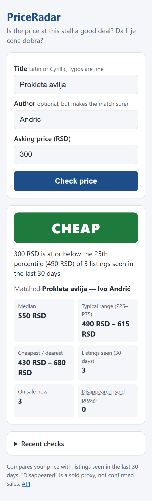
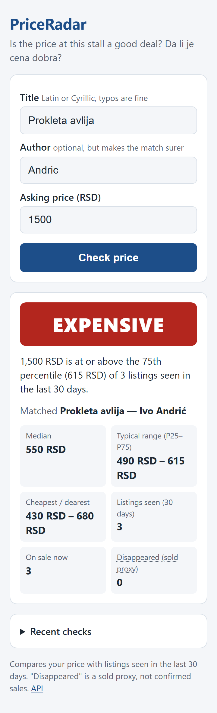
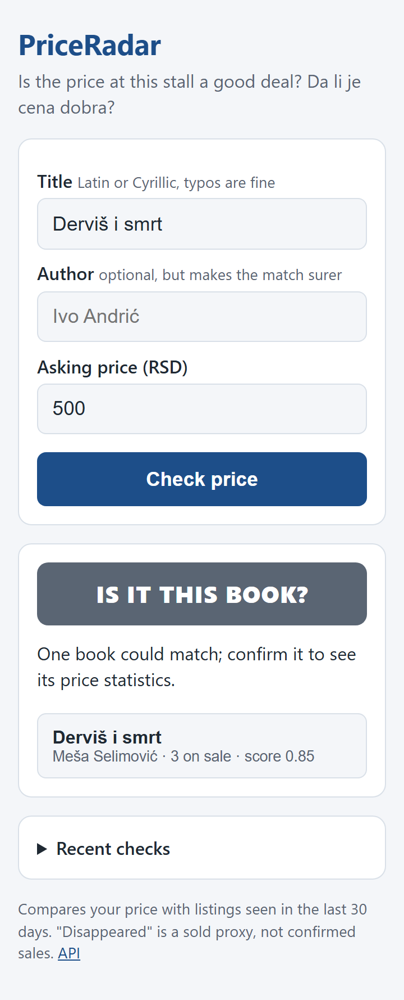
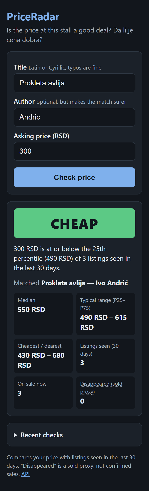
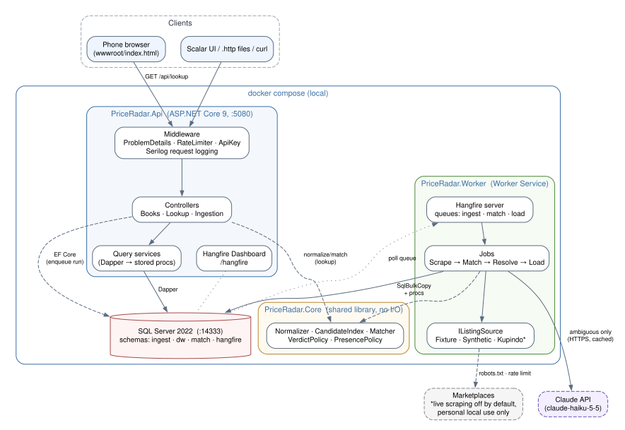
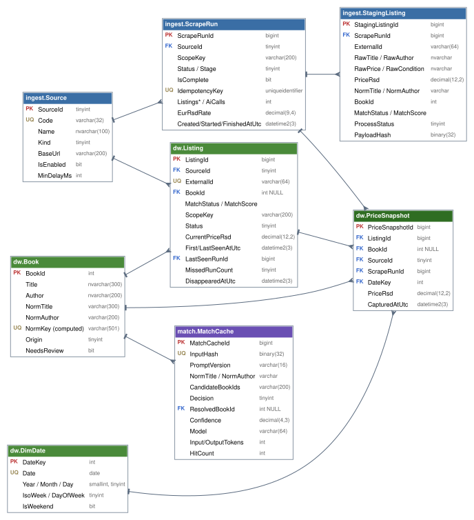

# PriceRadar

[](https://github.com/damjanxp/priceradar/actions/workflows/ci.yml)


**Is the price at this flea-market stall cheap, fair or expensive?** PriceRadar collects used-book listings from Serbian
marketplaces into a small data warehouse and answers that question from your phone in about 20 ms.

<p>
  
  
  
  
</p>

Built in 10 days from a written specification: [`docs/spec/PriceRadar-Spec.md`](docs/spec/PriceRadar-Spec.md)
([PDF](docs/spec/PriceRadar-Spec.pdf)). Every number below was measured and is reproducible from this repository.

## The problem

A flea-market stall has *Prokleta avlija* for 600 dinars. Is that a good price? The same book is
listed on Kupindo and KupujemProdajem in a dozen spellings ("PROKLETA AVLIJA - Ivo Andric, kao nova", "Проклета
авлија"), there is no ISBN, and the marketplaces never say what actually sold. PriceRadar turns that noise into one
canonical book with a price distribution and a verdict.

## What it does

- **Ingests** listings through a Hangfire pipeline: scrape → match → resolve → load, each step idempotent
  and retryable.
- **Matches** messy titles to canonical books: Cyrillic ↔ Latin, diacritics, noise words, typos, volume numbers.
  Clear cases are decided by rules and fuzzy scores; only the uncertain band goes to the Claude API, cached forever.
- **Stores history** in a star-schema warehouse (`dw.PriceSnapshot`, one row per listing per run) and tracks when a
  listing disappears as a *sold proxy*.
- **Answers** `GET /api/lookup?title=&author=&askingPrice=` with *cheap / fair / expensive* against the 25th–75th
  percentile of the last 30 days, plus the stats behind it. A mobile page at `/` calls it.
- **Exposes** books, price history and ingestion runs as a REST API with RFC 9457 errors, API-key protection for writes,
  rate limiting, health checks and OpenAPI.



| Project | Role |
|---|---|
| `src/PriceRadar.Core` | Normalisation, matching, verdict rules. No I/O, no framework dependencies (enforced by tests). |
| `src/PriceRadar.Infrastructure` | EF Core model and migrations, SQL procedures, Dapper queries, sources, Hangfire jobs, Claude client. |
| `src/PriceRadar.Api` | ASP.NET Core Web API, the lookup page (`wwwroot`), Hangfire dashboard, health checks. |
| `src/PriceRadar.Worker` | Worker Service hosting the Hangfire server that runs the jobs. |
| `tools/PriceRadar.Seeder` | Generates a reproducible synthetic warehouse (20k books, 60k listings, 500k snapshots). |
| `tests/*` | 186 unit tests (xUnit, Shouldly, NetArchTest) and 35 integration tests (Testcontainers SQL Server). |

## Quick start

Prerequisites: **Docker Desktop** and the **.NET SDK 9.0.3xx** (pinned in `global.json`). About 10 minutes.

```powershell
git clone https://github.com/damjanxp/priceradar.git ; cd priceradar
Copy-Item .env.example .env                 # optionally set your own MSSQL_SA_PASSWORD
docker compose up -d --build                # SQL Server (localhost,14333), Api (localhost:5080), Worker
curl.exe -s http://localhost:5080/health/ready
```

Load data. Either run the three fixture ingestions (real pipeline, ~150 listings) or seed the large synthetic warehouse:

```powershell
# a) Pipeline on fixture data: watch it at http://localhost:5080/hangfire
curl.exe -s -X POST http://localhost:5080/api/ingestion/runs -H "X-Api-Key: dev-key" -H "Content-Type: application/json" -d '{\"source\":\"fixture\",\"fixtureSet\":\"run-001\"}'
curl.exe -s http://localhost:5080/api/ingestion/runs        # wait for "succeeded", then run-002, run-003

# b) Synthetic warehouse for benchmarks (~20 s). The password is the one in .env.
dotnet user-secrets set "ConnectionStrings:Sql" "Server=localhost,14333;Database=PriceRadar;User Id=sa;Password=<MSSQL_SA_PASSWORD>;TrustServerCertificate=True" --project src/PriceRadar.Api
dotnet run --project tools/PriceRadar.Seeder -c Release -- seed --seed 42 --reset
```

Then ask:

- Phone page: <http://localhost:5080/> (from a phone on the same Wi-Fi: `http://<pc-ip>:5080/`)
- API: `curl.exe -s "http://localhost:5080/api/lookup?title=Prokleta%20avlija&author=Andric&askingPrice=600"`
- API reference: <http://localhost:5080/scalar>, or the requests in `src/PriceRadar.Api/PriceRadar.Api.http`

`docker compose stop` stops everything; `docker compose down -v` also deletes the database.

## Tech stack, and why

| Choice | Why |
|---|---|
| .NET 9 / C# 13, modular monolith | One deployable, clear project boundaries; microservices would be ceremony at this size. |
| SQL Server 2022 | Window functions, `PERCENTILE_CONT`, columnstore batch mode, Query Store: the performance story needs them. |
| EF Core **and** Dapper | EF for the schema, migrations and writes; Dapper for the hand-tuned read procedures. |
| Hangfire on SQL Server | Durable, retryable jobs with a dashboard, no extra broker to run. |
| FuzzySharp + Jaro-Winkler | Token-set ratios survive word order and extra words; Jaro-Winkler suits short author names. |
| Claude API (Haiku) via typed `HttpClient` | Only for the ambiguous band, JSON-schema output, resilience handler, DB cache and budget cap (D-15…D-18). |
| Testcontainers | Integration tests run against a real SQL Server 2022, the same as production. |

The full Decision Log (40 decisions with alternatives and trade-offs) is in spec §15.

## Data model



Listings land in `ingest.StagingListing` through `SqlBulkCopy` (~60k rows/s). `MatchJob` attaches each one to a
`dw.Book` (or proposes a new one) and sends the batch to SQL as a table-valued parameter. `dw.usp_LoadRun` MERGEs
listings and inserts one `dw.PriceSnapshot` per listing and run; re-running the same run inserts nothing.
`dw.usp_UpdateListingPresence` marks a listing *Disappeared* after it is missing from two consecutive runs.

## Matching

| Input | Normalised |
|---|---|
| `PROKLETA AVLIJA - Ivo Andrić, kao nova` | `prokleta avlija` / `ivo andric` |
| `Проклета авлија` | `prokleta avlija` |
| `Seobe II knjiga` | `seobe 2` |

Score = `0.7 · title + 0.3 · author`. At ≥ 0.90 with a 0.05 margin over the runner-up it matches automatically; below
0.65 it creates a new book; in between, the Claude API decides (at most once per distinct string thanks to the cache,
max 200 calls per run, $0.50 per day). Measured on a 169-listing hand-labelled golden set (`tests/fixtures/matching/`):

| Auto-match precision | Auto-match recall | Sent to Claude | Wrong auto-matches |
|---|---|---|---|
| **100.0 %** | **88.7 %** | 11.8 % | 0 |

On the fixture runs, fuzzy matching cut new-book creation from 52 to 21 books compared with exact matching. No real
Claude call has been made in this repository's tests: they use a stub, and the resolver is verified against the
documented request/response format.

## Performance

500,000 price snapshots, SQL Server in a 2 GB container on a laptop. Full method, plans and raw results:
[`docs/benchmarks/BENCHMARKS.md`](docs/benchmarks/BENCHMARKS.md).

| Query | Before (reads · ms) | After (reads · ms) |
|---|---|---|
| Book stats, hottest book (8,275 snapshots) | 6,809 · 21 | **49 · 5** |
| Weekly price history, 180 days | 55,457 · 40 | **56 · 9** |
| `GET /api/lookup` under load (k6, 10 VUs, 60 s) | p95 145.9 ms, 101 req/s | **p95 18.5 ms, 838 req/s** |

The fix was a covering index `(BookId, DateKey) INCLUDE (…)` plus an *empty* filtered columnstore index whose only job
is to let the optimiser use batch mode for the window aggregates: it removed a 50k-read worktable, built in 29 ms and
costs nothing on insert (D-40). Parameter sniffing between hot and cold books was checked through the plan cache and
Query Store and is not a problem with the final index.

## Reliability and operations

- Each job takes only the run id, checks the run's stage first and is safe to repeat; a Hangfire filter marks the run
  Failed only after the last retry. A filtered unique index allows one active run per source.
- Structured Serilog logs: every job line carries `RunId` and `Job`, every request a `CorrelationId` that is echoed in
  `X-Correlation-Id` and matches the `traceId` of error responses.
- `/health` (liveness) and `/health/ready` (SQL + Hangfire storage); containers run as non-root with healthchecks.
- [`docs/debugging.md`](docs/debugging.md): six real incidents from the build, from a startup race after SQL Server
  restarts to a columnstore build stuck on `RESOURCE_SEMAPHORE`, each diagnosed from logs and DMVs.

## Testing

```powershell
dotnet test -c Release                                   # needs Docker running for the integration tests
dotnet test tests/PriceRadar.UnitTests                    # unit tests only, no Docker
python docs/evidence/capture_ui.py                        # phone screenshots of the running stack
```

| Layer | Count | What it proves |
|---|---|---|
| Unit | 186 | Normaliser, scorer, decider, verdict rules, golden set, architecture rules (Core has no I/O dependencies, controllers contain no SQL) |
| Integration | 35 | Full pipeline on a real SQL Server: idempotent re-runs, sold heuristic, stats procedures, AI cache, API contract and errors, API key, correlation id |

Line coverage over both suites is 94.7 % (Core 87.3 %). CI runs three jobs on every push: **lint** (gitleaks secret
scan, `dotnet format`), **build-test** (all tests with coverage summary), **docker** (both images build).

The lookup page scores 100 for accessibility and best practices in a Lighthouse mobile run, has no horizontal scroll at
360 px and works under a strict `default-src 'self'` Content Security Policy.

## Ethics and limitations

- **No live scraping yet.** All data comes from fixture files and the synthetic generator. The planned Kupindo
  source (category pages only, as its robots.txt allows; off by default; personal local use) is registered but not
  implemented: it was the first item cut from the plan. KupujemProdajem's terms forbid copying, so its data here is
  an invented fixture in KP's format (D-37, D-39).
- **"Sold" is a proxy.** A listing that disappears may have been sold, withdrawn or expired. The page says so.
- **Small samples.** With fewer than 3 listings in 30 days the verdict is *not enough data* instead of a guess.
- **Synthetic data.** The 500k-row warehouse is generated; the benchmarks measure SQL behaviour, not market prices.

## How I used AI tools

The project was built with Claude Code as a pair programmer: the specification was written first and used as context,
one day per session, tests before code, and every commit reviewed by me. The log of what went wrong and how it was
caught is in [`docs/ai-usage.md`](docs/ai-usage.md). The short version: the golden set, the integration tests and the
measurements caught mistakes that looked right, including a benchmark method that silently measured the wrong thing.

## Roadmap

The polite Kupindo category-page source first, then spec §2.4: Azure hosting, a manual match-review endpoint, IQR
outlier exclusion, a PWA shell, images on GHCR, OpenTelemetry traces.

## License

MIT, see [`LICENSE`](LICENSE). Any live-source code is for personal local use within each site's terms.
