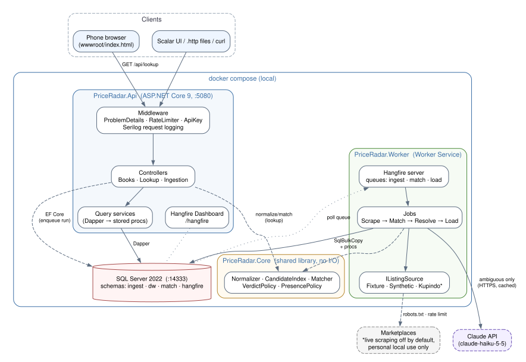
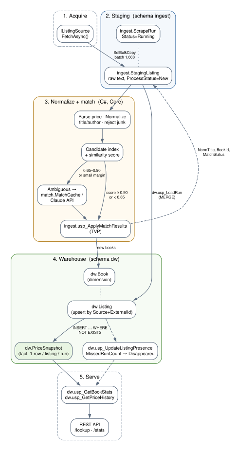
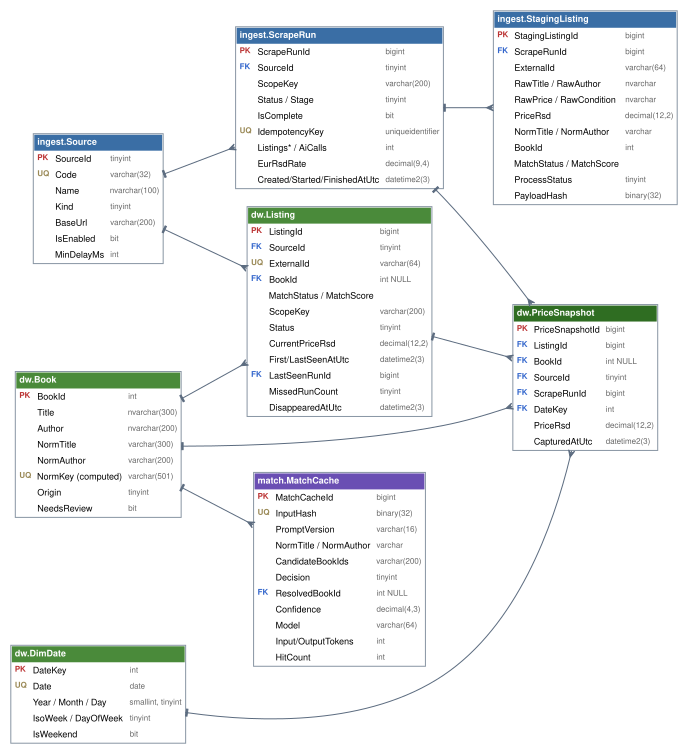
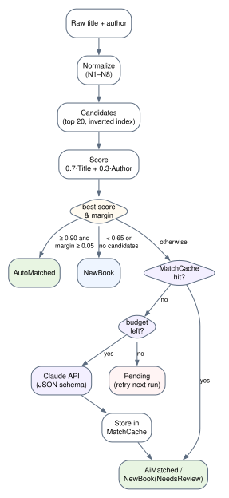

# PriceRadar — Technical Specification

**Market price intelligence for used books (Serbian marketplaces)**

| Field | Value |
|---|---|
| Document | PriceRadar Technical Specification (MVP) |
| Version | 1.4 |
| Status | Approved for implementation; the pre-Day-1 decisions in §1.3 are confirmed |
| Date | 2026-10-28 |
| Author | Damjan Petrov (FTN Novi Sad) — with Claude Code as AI pair-architect |
| Source of truth | `docs/spec/PriceRadar-Spec.md` (this file). The PDF is a rendered copy. |
| Build | `python docs/spec/tools/build_pdf.py` → `docs/spec/PriceRadar-Spec.pdf` |

## 1. Document control

### 1.1 Revision history

| Version | Date | Author | Change |
|---|---|---|---|
| 0.9 | 2026-10-28 | D. Petrov / Claude | First full draft generated from the project brief |
| 1.0 | 2026-10-28 | D. Petrov / Claude | QA pass on PDF layout; Decision Log completed |
| 1.1 | 2026-10-28 | D. Petrov / Claude | Open questions in §1.3 confirmed; D-37 and D-38 added |
| 1.2 | 2026-10-28 | D. Petrov / Claude | DAY-1 commands corrected after the first run (local dotnet-ef manifest, user-secrets step, two failure symptoms) |
| 1.4 | 2026-10-28 | D. Petrov / Claude | DAY-2 results folded in: Zipf–Mandelbrot skew (q = 10), measured seed output, `sqlcmd -I` failure symptom |
| 1.3 | 2026-10-28 | D. Petrov / Claude | KupujemProdajem becomes a synthetic fixture source (its ToS §11 forbids scraping); live Kupindo limited to category pages (robots.txt blocks search); D-37 revised, D-39 added |

### 1.2 Conventions used in this document

- **Stable IDs.** Functional requirements `FR-n`, non-functional `NFR-n`, decisions `D-nn`, risks `R-n`, plan days `DAY-n`. IDs are never renumbered; removed items are marked *withdrawn*.
- **MVP vs Stretch.** Everything not explicitly labelled **Stretch** is in the 10-day MVP. Stretch items are collected in §2.4.
- **Commands** are written for PowerShell 7 or Git Bash on Windows 11. On Windows PowerShell 5.1 use `curl.exe`, not the `curl` alias. Ports: API `5080`, SQL Server `14333`, Seq `8081`.
- **Money** is always Serbian dinars (RSD), `decimal(12,2)`. **Time** is UTC (`datetime2(3)`, `...Utc` suffix).
- SQL snippets are *illustrative design sketches* to pin down behaviour; the final code is written during the plan.

### 1.3 Pre-Day-1 decisions (confirmed 2026-10-28)

1. **.NET 9 vs .NET 10 LTS** (see D-01). .NET 9 is an STS release whose support ends in November 2026; the job ad asks for .NET 9, so the MVP targets `net9.0`, and retargeting to `net10.0` is a Stretch item. **Confirmed** (D-01).
2. **Which live marketplace?** The MVP ships one *optional* live source, Kupindo (book-centric), limited to category pages. KupujemProdajem's Terms of Use (§11) forbid manual or automated scraping, so it is represented by a KP-style **synthetic** fixture source only (see §4.5 and R-10). **Confirmed** (D-37, D-39).
3. **Phone access at the market.** A phone at a flea market cannot reach `localhost`. The MVP is usable on home Wi-Fi or through a tunnel (`devtunnel`/`cloudflared`); a real public URL needs the Azure Stretch item. **Confirmed** as sufficient for the CV demo (D-38).

## 2. Executive summary, goals and non-goals

### 2.1 Executive summary

PriceRadar answers one question at a Sunday flea market: *"This seller wants 400 dinars for* Na Drini ćuprija *— is that cheap?"* A .NET 9 ingestion pipeline pulls used-book listings from online marketplaces on demand, lands them in a SQL Server **staging** area, normalises and fuzzy-matches them to **canonical books** (title + author, no ISBN, with Serbian Cyrillic/Latin and diacritic handling), and loads them into a small **warehouse** model: dimensions (`Book`, `Source`, `Date`, `Listing`) and a fact table (`PriceSnapshot`). The Claude API resolves only the ambiguous matches, and every answer is cached in the database. A REST API gives per-book supply and price statistics (min/max/median/P25/P75), a *disappeared-listing* proxy for "sold in the last 30 days", and a `lookup` endpoint that returns a **cheap / fair / expensive** verdict. A one-page mobile web UI calls it.

The project is built as **CV evidence** for a mid-level Backend C# role. Every claim must be backed by an artefact: benchmark tables with before/after numbers on 500k fact rows, Testcontainers integration tests, a green GitHub Actions pipeline, structured logs, and an honest README, including a section on how AI tools were used.

### 2.2 Goals

| ID | Goal | Evidence at the end |
|---|---|---|
| G-1 | Working end-to-end pipeline: trigger → scrape → stage → match → warehouse → API | Hangfire dashboard screenshot, SQL row counts |
| G-2 | Credible SQL Server engineering: stored procedures, percentiles, indexing, measured optimisation | `docs/benchmarks/BENCHMARKS.md` with before/after table and saved plans |
| G-3 | Serbian-aware fuzzy matching with AI only for the hard cases, at near-zero cost | Golden-set precision/recall table; AI call count and cost per run |
| G-4 | Production-style quality: tests, CI, ProblemDetails, health checks, structured logs | Green CI badge, test count, coverage report |
| G-5 | Demonstrable, documented AI-assisted workflow | README "How I used AI tools" section |

### 2.3 Non-goals (explicitly out of scope for the MVP)

- Scheduled or continuous scraping. Runs are **manually triggered** only.
- Crawling at scale, proxy rotation, CAPTCHA solving, login-walled content, or bypassing anti-bot measures. These will never be built.
- Storing personal data about sellers (names, phone numbers, profiles).
- Edition-level identity (publisher, year, cover type). Editions are merged into one canonical book (D-11).
- User accounts, JWT, multi-tenancy, payments, notifications.
- A SPA frontend. The UI is a single static page.
- Price prediction or ML models. Statistics only.
- Ground truth for "sold". The heuristic is a labelled proxy (§7).

### 2.4 Stretch list (only after DAY-10's Definition of Done is met)

S-1 Azure deployment (App Service + Azure SQL free offer) · S-2 second live source · S-3 JWT auth · S-4 retarget to .NET 10 LTS · S-5 EF Core migration bundle as a compose `migrator` service · S-6 keyset pagination · S-7 edition/publisher dimension · S-8 manual match-review endpoint (`POST /api/listings/{id}/match`) · S-9 IQR outlier exclusion in stats · S-10 PWA manifest/offline shell · S-11 publishing Docker images to GHCR · S-12 SQL-side candidate generation (n-gram table) · S-13 OpenTelemetry traces.

## 3. Requirements

### 3.1 Functional requirements

| ID | Requirement | Priority | Verified by |
|---|---|---|---|
| FR-1 | The system shall support multiple listing sources behind `IListingSource`; the MVP includes `fixture`, `kp` (KP-style synthetic fixtures), `synthetic` and an optional, disabled-by-default `kupindo` source (category pages only). | Must | Unit + integration tests |
| FR-2 | A user shall trigger an ingestion run via `POST /api/ingestion/runs` (source, optional query, max pages). The run executes asynchronously in the Worker. | Must | API test, Hangfire dashboard |
| FR-3 | Only one run per source may be active at a time; a second request returns `409 Conflict`. | Must | Integration test |
| FR-4 | Every fetched listing shall be written unchanged (raw text) to `ingest.StagingListing` before any transformation. | Must | SQL check |
| FR-5 | Prices shall be parsed from raw text (`"1.200 din"`, `"1.200,00 RSD"`, `"15 €"`) into RSD; non-prices (`"Dogovor"`, empty) and out-of-range values (< 50 or > 200,000 RSD) are rejected with a reason code. | Must | Unit tests |
| FR-6 | Titles and authors shall be normalised per §6.1 (Cyrillic→Latin, diacritic folding, casing, punctuation, noise removal). | Must | Unit tests (theory data) |
| FR-7 | Each listing shall be matched to a canonical `dw.Book` as *AutoMatched*, *AiMatched*, *NewBook* or *Pending*, using the thresholds in §6.4. | Must | Golden-set test |
| FR-8 | Ambiguous matches shall be resolved by the Claude API using the contract in §6.5. Results are stored in `match.MatchCache`, and the same normalised input is never sent twice for the same prompt version. | Must | Integration test with fake handler; cache hit counter |
| FR-9 | AI usage shall be bounded per run (`Ai:MaxCallsPerRun`) and per day (`Ai:DailyBudgetUsd`). When the budget is exhausted, listings stay *Pending* and are retried on the next run. | Must | Unit test |
| FR-10 | Loading shall upsert `dw.Listing` by `(SourceId, ExternalId)` and insert at most one `dw.PriceSnapshot` per listing per run. | Must | Idempotency integration test |
| FR-11 | Listing presence shall be tracked; a listing missing from N (default 2) consecutive complete, successful runs of the same scope becomes *Disappeared* (§7). | Must | Fixture run-001..003 test |
| FR-12 | `GET /api/books` shall list books with search (`q`), pagination and sorting. | Must | API test |
| FR-13 | `GET /api/books/{id}/stats` shall return supply, min, max, median, P25, P75 and the disappeared-in-window count for a configurable window (default 30 days). | Must | Proc test with hand-computed values |
| FR-14 | `GET /api/books/{id}/listings` and `/price-history` shall return the listings and a daily/weekly price series. | Must | API test |
| FR-15 | `GET /api/lookup?title=&author=&askingPrice=` shall return a match result, statistics and a verdict (`cheap`/`fair`/`expensive`/`insufficient_data`/`unknown`) per §8.4, without calling the Claude API synchronously. | Must | API test |
| FR-16 | A mobile-friendly page at `/` shall call the lookup endpoint and show the verdict prominently. | Should | Manual smoke on phone |
| FR-17 | `GET /api/ingestion/runs` and `/{id}` shall expose run status, stage, counts, AI calls and errors. | Must | API test |
| FR-18 | A seeder tool shall generate a deterministic synthetic dataset (≥ 20k books, 60k listings, 500k snapshots) via `SqlBulkCopy`. | Must | Row counts, timing |
| FR-19 | `GET /health` (liveness) and `/health/ready` (SQL + Hangfire storage) shall report status. | Must | curl |

### 3.2 Non-functional requirements

| ID | Category | Requirement (target) | How measured |
|---|---|---|---|
| NFR-1 | Performance | `GET /api/lookup` **p95 < 200 ms** server-side with 500k snapshots / 60k listings / 20k books, warm cache, 10 concurrent users for 60 s on the local Docker stack. | k6 (§11.5), Serilog request timings |
| NFR-2 | Performance | `dw.usp_GetBookStats` for the *hottest* book (largest snapshot count): < 50 ms elapsed and < 1,000 logical reads after optimisation. | `SET STATISTICS IO, TIME` |
| NFR-3 | Performance | Seeding 500k snapshots in < 60 s; loading a 1,000-listing run (excluding network delays) in < 30 s. | Stopwatch log lines |
| NFR-4 | Reliability | Re-executing any job for the same run produces no duplicates and the same final row counts (idempotency). | Integration test |
| NFR-5 | Reliability | Transient failures (HTTP 5xx/429, SQL deadlock/timeouts) are retried with backoff; permanent failures mark the run `Failed` with a message. | Fault-injection unit tests, dashboard |
| NFR-6 | Observability | Structured JSON logs with `RunId`, `JobId`, `CorrelationId`, `Source`; health endpoints; Hangfire dashboard; per-run counters in `ingest.ScrapeRun`. | Log sample in README |
| NFR-7 | Security | No secret in the git history (API keys, SA password); gitleaks runs in CI; write endpoints require `X-Api-Key` when one is configured; lookup is rate-limited (60 req/min/IP). | CI step, 401/429 tests |
| NFR-8 | Maintainability | Layering enforced by architecture tests; nullable enabled; warnings as errors; central package versions; ≥ 70 % line coverage on `PriceRadar.Core`. | NetArchTest, coverlet report |
| NFR-9 | Portability | A fresh clone runs with `docker compose up -d --build` plus one seeding command in < 10 minutes on a 16 GB laptop. | README quick-start timing |
| NFR-10 | Cost | Total Claude API spend for the whole project < 1 USD; per-run AI calls are visible. | `match.MatchCache` token sums |
| NFR-11 | Ethics | Live scraping obeys robots.txt, ≥ 3 s between requests per host, identifiable User-Agent, ≤ 10 pages per run. | Code review checklist, log lines |

## 4. Architecture

### 4.1 Component view

The system is a **modular monolith** deployed as two processes that share one database: the **Api** (HTTP, read models, job enqueueing, Hangfire dashboard) and the **Worker** (Hangfire server running the pipeline jobs). All business logic that needs no I/O (normalisation, scoring, verdicts, presence rules) lives in **Core**, so it is unit-testable and used identically by both processes (D-02).

{: .diagram-wide }

<p class="caption">Figure 1 — Component diagram. Dashed boxes are external or optional.</p>

### 4.2 Data flow (staging → normalised → fact)

{: .diagram-tall }

<p class="caption">Figure 2 — Data flow of one ingestion run.</p>

1. **Acquire.** `ScrapeJob` streams `RawListing` records from the source and bulk-inserts them into `ingest.StagingListing` in batches of 1,000 (`SqlBulkCopy`). Raw text is never modified in place.
2. **Normalise + match.** `MatchJob` reads the run's staging rows, parses prices, normalises text, generates candidates and scores them in memory. Results go back through a table-valued parameter (`ingest.usp_ApplyMatchResults`). `ResolveJob` sends only ambiguous rows to the cache/Claude.
3. **Load.** `LoadJob` calls `dw.usp_LoadRun`: it creates the new books, merges `dw.Listing` and inserts `dw.PriceSnapshot` with `NOT EXISTS`. It then calls `dw.usp_UpdateListingPresence` for the sold heuristic.
4. **Serve.** The API reads through Dapper → stored procedures (`dw.usp_GetBookStats`, `dw.usp_GetPriceHistory`) and plain parameterised queries for lists.

### 4.3 Solution and folder structure

```text
PriceRadar/
├─ PriceRadar.sln
├─ global.json                  # pins .NET SDK 9.0.x
├─ Directory.Build.props        # net9.0, LangVersion 13, Nullable, TreatWarningsAsErrors
├─ Directory.Packages.props     # central package versions
├─ docker-compose.yml  .env.example  .editorconfig  .gitignore
├─ src/
│  ├─ PriceRadar.Core/              # domain + application logic, NO I/O
│  │  ├─ Domain/                    # Book, Listing, ScrapeRun, enums (MatchStatus, RunStatus…)
│  │  ├─ Normalization/             # TextNormalizer, SerbianTransliterator, NoiseLexicon, PriceParser
│  │  ├─ Matching/                  # CandidateIndex, SimilarityScorer, MatchDecider, MatchOptions
│  │  ├─ Pricing/                   # VerdictPolicy, PriceStats
│  │  ├─ Presence/                  # PresencePolicy (sold heuristic rules)
│  │  └─ Abstractions/              # IListingSource, IAiMatchResolver, IClock, I*Repository
│  ├─ PriceRadar.Infrastructure/
│  │  ├─ Persistence/               # PriceRadarDbContext, configurations, Migrations/
│  │  ├─ Sql/                       # *.sql stored procedures + TVP types (embedded resources)
│  │  ├─ Queries/                   # Dapper query services (BookStatsQuery, LookupQuery…)
│  │  ├─ Staging/                   # StagingBulkWriter (SqlBulkCopy)
│  │  ├─ Sources/                   # FixtureListingSource, SyntheticListingSource, Kupindo/ (live, off)
│  │  ├─ Ai/                        # ClaudeMatchResolver (typed HttpClient), MatchCacheRepository
│  │  └─ Jobs/                      # ScrapeJob, MatchJob, ResolveJob, LoadJob, RunStateFilter
│  ├─ PriceRadar.Api/               # controllers, ProblemDetails, rate limiting, wwwroot/index.html
│  └─ PriceRadar.Worker/            # Hangfire server host
├─ tools/PriceRadar.Seeder/         # synthetic data + fixture staging CLI
├─ tests/
│  ├─ PriceRadar.UnitTests/
│  ├─ PriceRadar.IntegrationTests/  # Testcontainers MsSql, WebApplicationFactory
│  └─ fixtures/                     # sources/fixture/run-001..003.json, matching-golden.csv
├─ db/benchmarks/                   # benchmark .sql scripts
├─ perf/lookup.js                   # k6 script
├─ docs/  spec/  benchmarks/  evidence/  adr/(optional)
└─ .github/workflows/ci.yml
```

### 4.4 Layering rules

| Project | May reference | Must not reference |
|---|---|---|
| `PriceRadar.Core` | BCL, FuzzySharp (pure algorithm library) | EF Core, Dapper, SqlClient, Hangfire, ASP.NET Core, `HttpClient` |
| `PriceRadar.Infrastructure` | Core, EF Core, Dapper, SqlClient, Hangfire, `Microsoft.Extensions.Http.Resilience` | Api, Worker |
| `PriceRadar.Api` | Core, Infrastructure (composition root only) | Worker |
| `PriceRadar.Worker` | Core, Infrastructure | Api |
| Tests | anything | — |

The rules are enforced by a NetArchTest test in `PriceRadar.UnitTests` (`ArchitectureTests.Core_has_no_infrastructure_dependencies`). Controllers contain no SQL: they call query services or application services. Jobs receive only a `scrapeRunId` (a primitive argument) and re-load state from the database (D-23).

### 4.5 Ethics and safety of scraping

**Design.** All acquisition goes through one interface, so the rest of the system cannot tell where data came from:

```csharp
public interface IListingSource
{
    string Code { get; }                                     // "fixture", "synthetic", "kupindo"
    IAsyncEnumerable<RawListing> FetchAsync(ScrapeRequest request, CancellationToken ct);
}
```

| Source | Ships in public repo | Enabled by default | Purpose |
|---|---|---|---|
| `FixtureListingSource` (`fixture`) | Yes — reads `tests/fixtures/sources/fixture/run-00N.json` | Yes | Deterministic demos and tests, including the 3-run sold-heuristic scenario |
| `FixtureListingSource` (`kp`) | Yes — reads `tests/fixtures/sources/kp/run-00N.json`; **invented** ads in KupujemProdajem's style (EUR prices, "Dogovor", KP condition labels) | Yes | Second marketplace: cross-source matching, EUR→RSD conversion, per-source stats. No real KP content (D-39) |
| `SyntheticListingSource` | Yes — generator with seed | Yes | Volume testing; same generator as the Seeder |
| `KupindoListingSource` | Yes (code) — "for personal local use" banner in README | **No** (`Sources:Kupindo:Enabled=false`) | Real data on my own machine only; **category pages only** — Kupindo's robots.txt disallows `/pretraga*.php` (search), `/*/Sledeci`, `/*/cena_ASC`, `/*/cena_DESC` and `/kupljeno/*` |

**Rules every live source must follow** (enforced in a shared `PoliteHttpHandler` + a review checklist):

1. Fetch and obey `robots.txt` (cached 24 h); disallowed paths → abort the run with `RobotsDisallowed`.
2. Read and respect the site's Terms of Use. If automated access is prohibited, the source stays fixture-only. Checked 2026-10-28: KupujemProdajem §11 forbids *"ručno ili softversko, neovlašćeno kopiranje i skrejpovanje"* of ads → synthetic fixtures only (D-39). Limundo/Kupindo terms forbid overloading the site and republishing content without consent → personal local use, never published (D-37).
3. Rate limit: one request at a time per host, ≥ `MinDelayMs` (default 4,000 ms) between requests, ≤ `MaxPages` (10) per run; manual trigger only.
4. Identifiable User-Agent: `PriceRadar/0.1 (+https://github.com/<user>/priceradar; personal non-commercial research)`.
5. Back off on 429/503 (honour `Retry-After`); stop the run on 403 or CAPTCHA pages, and **never** attempt to bypass them.
6. Data minimisation: store ad title, price, condition, URL and posted date only. **No seller names, phone numbers or profile links** (personal data under Serbia's Law on Personal Data Protection).
7. Never commit scraped pages or real listing data. Fixtures are synthetic or hand-written look-alikes.

## 5. Data model

### 5.1 Schemas

| Schema | Purpose | Owner |
|---|---|---|
| `ingest` | Sources, runs, raw staging rows; write-heavy, append-mostly | EF Core migrations |
| `dw` | Warehouse: dimensions (`Book`, `DimDate`, `Listing`) and fact (`PriceSnapshot`) | EF Core migrations + `.sql` procs |
| `match` | AI match cache and usage accounting | EF Core migrations |
| `hangfire` | Hangfire job storage | Hangfire (auto-created) |

{: .diagram-er }

<p class="caption">Figure 3 — Entity-relationship diagram (crow's foot = many).</p>

### 5.2 Tables

Keys: **PK** primary key, **FK** foreign key, **UQ** unique. All `...AtUtc` columns are `datetime2(3)`. Status columns are `tinyint` mapped to C# enums (values in brackets).

**`ingest.Source`** — reference data (seeded by migration).

| Column | Type | Null | Notes |
|---|---|---|---|
| SourceId | tinyint | no | PK |
| Code | varchar(32) | no | UQ: `fixture`, `synthetic`, `kupindo`, `kp` |
| Name | nvarchar(100) | no | Display name |
| Kind | tinyint | no | [0 Fixture, 1 Synthetic, 2 Live] |
| BaseUrl | varchar(200) | yes | Live sources only |
| IsEnabled | bit | no | Live sources default to 0 |
| MinDelayMs | int | no | Politeness delay between requests (≥ 3000 for live) |
| CreatedAtUtc | datetime2(3) | no | |

**`ingest.ScrapeRun`** — one row per triggered run; also the pipeline's state machine.

| Column | Type | Null | Notes |
|---|---|---|---|
| ScrapeRunId | bigint identity | no | PK |
| SourceId | tinyint | no | FK → Source |
| ScopeKey | varchar(200) | no | Canonical scope, e.g. `kupindo:category:domaci-pisci` or `fixture:category:knjige`; used by the sold heuristic |
| Query | nvarchar(200) | yes | Free-text query, if any |
| Status | tinyint | no | [0 Queued, 1 Running, 2 Succeeded, 3 Failed, 4 Cancelled] |
| Stage | tinyint | no | [0 Created, 1 Scraped, 2 Matched, 3 Resolved, 4 Loaded] — the last completed step |
| IsComplete | bit | no | 1 when every page in scope was fetched (no page cap hit, no page error) |
| MaxPages / PagesFetched | smallint | no | |
| ListingsFetched / ListingsRejected / ListingsLoaded / AiCalls | int | no | Counters, default 0 |
| EurRsdRate | decimal(9,4) | no | Conversion rate frozen per run (config, default 117.2) |
| IdempotencyKey | uniqueidentifier | no | UQ; from the `Idempotency-Key` header or generated |
| RequestedBy | nvarchar(64) | yes | `api-key:<name>` or `anonymous` |
| CreatedAtUtc / StartedAtUtc / FinishedAtUtc | datetime2(3) | no/yes/yes | |
| ErrorMessage | nvarchar(2000) | yes | Last failure |
| HangfireJobId | varchar(64) | yes | First job in the chain |

Indexes: `UX_ScrapeRun_ActivePerSource (SourceId) WHERE Status IN (0,1)` — a *filtered unique* index that enforces FR-3 in the database, not only in code; `IX_ScrapeRun_Source_Created (SourceId, CreatedAtUtc DESC)` for the run list.

**`ingest.StagingListing`** — raw landing zone plus match write-back.

| Column | Type | Null | Notes |
|---|---|---|---|
| StagingListingId | bigint identity | no | PK |
| ScrapeRunId | bigint | no | FK → ScrapeRun |
| ExternalId | varchar(64) | no | Marketplace ad ID |
| RawTitle | nvarchar(400) | no | Exactly as scraped |
| RawAuthor | nvarchar(200) | yes | Often missing |
| RawPrice / RawCondition | nvarchar(50) / nvarchar(100) | yes | |
| Url | varchar(500) | no | |
| PostedAtUtc / ScrapedAtUtc | datetime2(3) | yes / no | |
| PayloadHash | binary(32) | no | SHA-256 of the raw fields (change detection, dedup) |
| PriceRsd | decimal(12,2) | yes | Filled by `MatchJob` |
| NormTitle / NormAuthor | varchar(300) / varchar(200) | yes | ASCII after normalisation (hence `varchar`) |
| BookId | int | yes | Resolved book |
| MatchStatus | tinyint | yes | [0 Pending, 1 AutoMatched, 2 AiMatched, 3 NewBook, 4 Manual] |
| MatchScore | decimal(5,4) | yes | Best similarity |
| ProcessStatus | tinyint | no | [0 New, 1 Normalized, 2 Loaded, 3 Rejected] |
| RejectReason | varchar(50) | yes | `NoPrice`, `PriceOutOfRange`, `EmptyTitle`, `Duplicate` |

Indexes: `UX_Staging_Run_External (ScrapeRunId, ExternalId)` (dedup inside a run); `IX_Staging_Run_Status (ScrapeRunId, ProcessStatus)`.

**`dw.Book`** — canonical book dimension.

| Column | Type | Null | Notes |
|---|---|---|---|
| BookId | int identity | no | PK |
| Title / Author | nvarchar(300) / nvarchar(200) | no / yes | Display form with diacritics, from the best observed listing |
| NormTitle / NormAuthor | varchar(300) / varchar(200) | no | `NormAuthor = ''` when unknown (never NULL, so the key below works) |
| NormKey | AS `NormAuthor + '\|' + NormTitle` PERSISTED | no | UQ — one canonical book per normalised (author, title) |
| Origin | tinyint | no | [0 Seed, 1 Rule, 2 Ai, 3 Manual] |
| NeedsReview | bit | no | Set when Claude answered `unsure` |
| CreatedAtUtc | datetime2(3) | no | |

**`dw.DimDate`** — classic date dimension, 2024-01-01 … 2030-12-31 (2,557 rows), seeded by a migration script. Columns: `DateKey int PK (yyyymmdd)`, `Date date UQ`, `Year smallint`, `Month tinyint`, `Day tinyint`, `IsoWeek tinyint`, `DayOfWeek tinyint (1 = Monday)`, `IsWeekend bit`. *Rationale:* integer date keys make range predicates cheap and allow weekly roll-ups without date functions on the fact column.

**`dw.Listing`** — one row per marketplace ad (a slowly changing, type-1 dimension).

| Column | Type | Null | Notes |
|---|---|---|---|
| ListingId | bigint identity | no | PK |
| SourceId | tinyint | no | FK → Source |
| ExternalId | varchar(64) | no | UQ with SourceId |
| BookId | int | yes | FK → Book; NULL while *Pending* |
| MatchStatus / MatchScore | tinyint / decimal(5,4) | no / yes | As in staging |
| Title / Condition / Url | nvarchar(400) / nvarchar(100) / varchar(500) | no/yes/no | Latest values (type-1 overwrite) |
| ScopeKey | varchar(200) | no | Scope in which the listing was first seen |
| Status | tinyint | no | [0 Active, 1 Disappeared] |
| CurrentPriceRsd | decimal(12,2) | no | Latest price |
| FirstSeenAtUtc / LastSeenAtUtc | datetime2(3) | no | |
| LastSeenRunId | bigint | no | FK → ScrapeRun |
| MissedRunCount | tinyint | no | Consecutive complete runs of the same scope without this listing |
| DisappearedAtUtc | datetime2(3) | yes | Set when Status becomes Disappeared; cleared on reappearance |
| RowVersion | rowversion | no | Optimistic concurrency for EF updates |

Indexes: `UX_Listing_Source_External (SourceId, ExternalId)`; `IX_Listing_Book_Status (BookId, Status) INCLUDE (CurrentPriceRsd, LastSeenAtUtc, DisappearedAtUtc)` for stats and listing pages; `IX_Listing_Scope_Status (SourceId, ScopeKey, Status) INCLUDE (LastSeenRunId, MissedRunCount)` for the presence update.

**`dw.PriceSnapshot`** — **fact table**. Grain: *one observed price of one listing in one successful run* (D-08).

| Column | Type | Null | Notes |
|---|---|---|---|
| PriceSnapshotId | bigint identity | no | PK, clustered (append-only, no page splits) |
| ListingId | bigint | no | FK → Listing |
| BookId | int | yes | FK → Book; **denormalised** from Listing for query speed (D-09); back-filled when a Pending listing is resolved |
| SourceId | tinyint | no | FK → Source (denormalised) |
| ScrapeRunId | bigint | no | FK → ScrapeRun |
| DateKey | int | no | FK → DimDate |
| PriceRsd | decimal(12,2) | no | Measure |
| CapturedAtUtc | datetime2(3) | no | |

Indexes: `UX_PriceSnapshot_Listing_Run (ListingId, ScrapeRunId)` — guarantees idempotent loads (FR-10). **Deliberately absent until DAY-6:** `IX_PriceSnapshot_Book_Date (BookId, DateKey) INCLUDE (ListingId, PriceRsd, CapturedAtUtc)`. Adding it is the measured "after" step of the benchmark (§11.4).

**`match.MatchCache`** — one row per distinct AI question.

| Column | Type | Null | Notes |
|---|---|---|---|
| MatchCacheId | bigint identity | no | PK |
| InputHash | binary(32) | no | UQ; SHA-256 of `PromptVersion \| NormTitle \| NormAuthor` (§6.6) |
| PromptVersion | varchar(16) | no | e.g. `v1` |
| NormTitle / NormAuthor | varchar(300) / varchar(200) | no | For debugging and analysis |
| CandidateBookIds | varchar(200) | no | CSV of the candidates shown to Claude |
| Decision | tinyint | no | [0 Match, 1 NewBook, 2 Unsure, 3 Error] |
| ResolvedBookId | int | yes | FK → Book |
| Confidence | decimal(4,3) | yes | 0–1 as returned |
| Reason | nvarchar(500) | yes | Short model explanation |
| Model | varchar(64) | no | Model ID actually used |
| InputTokens / OutputTokens / LatencyMs | int | no | Cost and latency accounting |
| CreatedAtUtc / LastHitAtUtc | datetime2(3) | no / yes | |
| HitCount | int | no | Incremented on every cache hit (evidence for the cost story) |

### 5.3 Stored procedures and types

| Object | Purpose | Called by |
|---|---|---|
| `ingest.MatchResultType` (TVP) | `(StagingListingId bigint, PriceRsd decimal(12,2) NULL, NormTitle, NormAuthor, BookId int NULL, MatchStatus tinyint, MatchScore decimal(5,4) NULL, ProcessStatus tinyint, RejectReason varchar(50) NULL, NewBookTitle nvarchar(300) NULL, NewBookAuthor nvarchar(200) NULL)` | MatchJob, ResolveJob |
| `ingest.usp_ApplyMatchResults @ScrapeRunId, @Results` | Set-based `UPDATE … FROM @Results` on staging | MatchJob, ResolveJob |
| `dw.usp_LoadRun @ScrapeRunId` | In one transaction: insert missing `dw.Book` rows by `NormKey`; `MERGE dw.Listing` on `(SourceId, ExternalId)`; `INSERT dw.PriceSnapshot … WHERE NOT EXISTS`; set staging `ProcessStatus = Loaded`; update run counters | LoadJob |
| `dw.usp_UpdateListingPresence @ScrapeRunId, @MissedRunsThreshold` | Sold heuristic (§7); no-op unless the run is `Succeeded` and `IsComplete = 1` | LoadJob |
| `dw.usp_GetBookStats @BookId, @WindowDays = 30, @AsOfUtc = NULL` | Two result sets: price distribution and supply/disappeared counts | `GET …/stats`, lookup |
| `dw.usp_GetPriceHistory @BookId, @FromDateKey, @ToDateKey, @Bucket ('day'\|'week')` | Min/median/max/count per bucket, joined to `dw.DimDate` | `GET …/price-history` |
| `dw.usp_ReassignListingBook @ListingId, @BookId` | Moves a listing and its snapshots to another book (used when Pending → resolved) | ResolveJob |

The stats procedure computes percentiles over the **latest price of each listing seen within the window**, so a listing observed in ten runs counts once (D-21). Illustrative sketch:

```sql
CREATE OR ALTER PROCEDURE dw.usp_GetBookStats
    @BookId int, @WindowDays int = 30, @AsOfUtc datetime2(3) = NULL
AS
BEGIN
    SET NOCOUNT ON;
    DECLARE @now datetime2(3) = COALESCE(@AsOfUtc, SYSUTCDATETIME());
    DECLARE @from datetime2(3) = DATEADD(day, -@WindowDays, @now);
    DECLARE @fromKey int = CONVERT(int, CONVERT(char(8), @from, 112));

    WITH latest AS (
        SELECT ps.PriceRsd,
               ROW_NUMBER() OVER (PARTITION BY ps.ListingId ORDER BY ps.CapturedAtUtc DESC) AS rn
        FROM dw.PriceSnapshot AS ps
        WHERE ps.BookId = @BookId AND ps.DateKey >= @fromKey
    )
    SELECT TOP (1)
        COUNT(*)      OVER () AS SampleSize,
        MIN(PriceRsd) OVER () AS MinPrice,
        MAX(PriceRsd) OVER () AS MaxPrice,
        PERCENTILE_CONT(0.25) WITHIN GROUP (ORDER BY PriceRsd) OVER () AS P25,
        PERCENTILE_CONT(0.50) WITHIN GROUP (ORDER BY PriceRsd) OVER () AS Median,
        PERCENTILE_CONT(0.75) WITHIN GROUP (ORDER BY PriceRsd) OVER () AS P75
    FROM latest WHERE rn = 1;

    SELECT SUM(CASE WHEN Status = 0 THEN 1 ELSE 0 END) AS ActiveListings,
           SUM(CASE WHEN Status = 1 AND DisappearedAtUtc >= @from THEN 1 ELSE 0 END) AS DisappearedInWindow
    FROM dw.Listing WHERE BookId = @BookId;
END
```

*Why `PERCENTILE_CONT` and not `APPROX_PERCENTILE_CONT`?* SQL Server 2022 offers both. Per-book samples are small (tens to a few thousand rows), so exact values are cheap and easy to test with hand-computed numbers. The approximate aggregate is a documented alternative for a future all-books report (D-21).

### 5.4 Index rationale summary

| Index | Query it serves | Why this shape |
|---|---|---|
| `UX_PriceSnapshot_Listing_Run` | Idempotent insert check | Uniqueness = correctness, not speed |
| `IX_PriceSnapshot_Book_Date` (DAY-6) | Stats & history by book + date range | Equality column first, range column second; `INCLUDE` makes it covering (no key lookups) |
| `IX_Listing_Book_Status` | Supply counts, listing page | Filters on BookId, groups by Status |
| `IX_Listing_Scope_Status` | Presence update per scope | Avoids scanning all listings per run |
| `UX_ScrapeRun_ActivePerSource` | One active run per source | Filtered unique index = race-free guard |
| `UX_Book_NormKey` | Exact-key match, new-book dedup | Makes concurrent "create book" safe |

## 6. Matching pipeline

### 6.1 Normalisation steps (`TextNormalizer`, Core)

Applied identically to listing titles/authors, canonical books and lookup queries.

| Step | Rule | Example |
|---|---|---|
| N1 | Unicode NFC, trim, collapse whitespace | `"Na  Drini\tćuprija "` → `"Na Drini ćuprija"` |
| N2 | Serbian Cyrillic → Latin (`љ→lj, њ→nj, џ→dž, ђ→đ, ћ→ć, ч→č, ш→š, ж→ž`, …) | `"На Дрини ћуприја"` → `"Na Drini ćuprija"` |
| N3 | Lower-case (invariant culture) | `"NA DRINI"` → `"na drini"` |
| N4 | Diacritic folding to ASCII: `č,ć→c`, `š→s`, `ž→z`, `đ→dj`, `dž→dz` (D-12) | `"ćuprija"` → `"cuprija"`, `"Đorđe"` → `"djordje"` |
| N5 | Punctuation and symbols → space (keep digits) | `"Prokleta avlija (1954.)"` → `"prokleta avlija 1954"` |
| N6 | Remove noise phrases (longest first) from `NoiseLexicon`: `kao nova`, `nova`, `novo`, `nekorisceno`, `odlicno ocuvana`, `ocuvana`, `izdanje`, `\d+\. izd`, `tvrd(i)? povez`, `meki povez`, `knjiga`, `roman`, `prodajem`, `hitno`, `akcija`, `povoljno`, `gratis`, `lot` | `"na drini cuprija kao nova tvrd povez"` → `"na drini cuprija"` |
| N7 | Remove 4-digit years 1900–2099; keep other numbers (volume numbers matter: `"Seobe 2"`) | `"prokleta avlija 1954"` → `"prokleta avlija"` |
| N8 | Author handling: split `"Author - Title"` / `"Title - Author"` when the author field is empty and one side matches a known author token set; author key = sorted surname-first tokens; single-letter initials kept as initials | `"Andric Ivo"`, `"I. Andric"` → tokens `{andric, ivo}` / `{andric, i}` |

The output is ASCII `varchar` (cheaper to index and compare). The display form keeps the original diacritics.

### 6.2 Candidate generation (`CandidateIndex`)

- An in-memory inverted index from title token → `BookId[]`, built from `dw.Book` at the start of each `MatchJob` (20k books ≈ a few MB; build time < 1 s) (D-13).
- Tokens shorter than 3 characters and the 50 most frequent tokens (IDF stop list) are not indexed.
- Candidates are the books sharing ≥ 1 indexed title token, ranked by the sum of IDF weights of the shared tokens; keep the top 20 (`Matching:MaxCandidates`). An exact `NormKey` hit short-circuits to score 1.0.
- The lookup endpoint uses the same index through a singleton that refreshes when `dw.Book` changes (version check every 60 s).

### 6.3 Similarity metric (`SimilarityScorer`)

```text
TitleSim  = 0.6 · TokenSetRatio(a, b) + 0.4 · TokenSortRatio(a, b)   # FuzzySharp, scaled 0..1
AuthorSim = 1.0                            # surnames equal, given names/initials compatible
          = JaroWinkler(surname_a, surname_b)                 # otherwise, 0..1
Score     = 0.7 · TitleSim + 0.3 · AuthorSim                  # both sides have an author
          = min(0.85 · TitleSim, 0.85)                        # listing has no author
```

*Plain language:* "token set ratio" asks how similar two strings are when word order and extra words are ignored, which is good for `"Na Drini cuprija - Ivo Andric roman"`. Jaro-Winkler is forgiving of typos at the end of short names (`"Andrc"` vs `"Andric"`). A listing without an author can never be auto-matched (cap 0.85 < 0.90), so Claude or a new book handles it. This is a deliberate precision-over-recall choice (D-14).

### 6.4 Thresholds and decisions (`MatchDecider`)

| Condition (best candidate score *s*, margin *m* = *s* − second best) | Decision | MatchStatus |
|---|---|---|
| Exact `NormKey` hit | Match | AutoMatched |
| *s* ≥ 0.90 and *m* ≥ 0.05 | Match | AutoMatched |
| *s* < 0.65 or no candidates | Create book | NewBook |
| otherwise (0.65 ≤ *s* < 0.90, or *m* < 0.05) | Ambiguous → cache → Claude | AiMatched / NewBook / Pending |

{: .diagram-match }

<p class="caption">Figure 4 — Matching decision flow for one listing.</p>

All values live in `Matching:*` configuration. They are **tuned on DAY-7** against `tests/fixtures/matching-golden.csv`: about 150 hand-labelled (listing, expected BookId or `NEW`) pairs covering Cyrillic, diacritics, swapped author order, typos, multi-volume works and "same title, different author" traps. A unit test prints precision/recall/ambiguous-rate per threshold pair, and the chosen pair is recorded in the README.

### 6.5 Claude prompt contract

- **Transport:** typed `HttpClient` (`IAiMatchResolver` → `ClaudeMatchResolver`), `POST https://api.anthropic.com/v1/messages`, headers `x-api-key`, `anthropic-version: 2026-10-21` (current API version), standard resilience handler (retry 429/5xx with jitter, honour `retry-after`, 20 s timeout) (D-16).
- **Model:** `Ai:Model` (default `claude-haiku-5-5`), `output_config.effort = "low"`, `max_tokens = 1024`. Haiku 5.5 thinks adaptively by default; low effort keeps it short. Do **not** send `temperature`/`top_p`/`top_k`: on API version `2026-10-21` any sampling parameter returns HTTP 400, so consistency comes from structured output plus the cache, not from temperature (D-17).
- **Output:** structured outputs via `output_config.format = { "type": "json_schema", "schema": … }`, so the response text is guaranteed to parse. The client reads the first `text` content block. `stop_reason` handling: `end_turn` → parse; `max_tokens` → `Error`; `refusal` → `Unsure`.

**System prompt (v1, frozen; any edit bumps `Ai:PromptVersion`):**

```text
You match second-hand book advertisements from Serbian marketplaces to a catalogue.
Ads may be Cyrillic or Latin, may omit diacritics, may swap author first/last name,
and may contain condition words ("kao nova", "tvrd povez") that are not part of the title.
Different translations or editions of the same work by the same author are the SAME book.
Different volumes ("Seobe 1" vs "Seobe 2") are DIFFERENT books.
Choose "match" only if one candidate is clearly the same work; choose "new_book" if none is;
choose "unsure" if you cannot tell. Never invent a bookId that is not in the candidates.
```

**Input (user message, JSON):**

```json
{
  "listing": { "title": "НА ДРИНИ ЋУПРИЈА - kao nova", "author": "I. Andrić",
               "normTitle": "na drini cuprija", "normAuthor": "andric i" },
  "candidates": [
    { "bookId": 1201, "title": "Na Drini ćuprija", "author": "Ivo Andrić", "score": 0.88 },
    { "bookId": 3307, "title": "Na Drini ćuprija (strip)", "author": "Zoran Penevski", "score": 0.71 }
  ]
}
```

**Output JSON schema:**

```json
{
  "type": "object",
  "additionalProperties": false,
  "required": ["decision", "bookId", "confidence", "reason"],
  "properties": {
    "decision":   { "type": "string", "enum": ["match", "new_book", "unsure"] },
    "bookId":     { "type": ["integer", "null"] },
    "confidence": { "type": "number" },
    "reason":     { "type": "string" }
  }
}
```

The client validates the semantics as well: when `decision = match`, `bookId` must be one of the candidate IDs, otherwise the answer is stored as `Error`. Confidence < 0.6 on a match is downgraded to `Unsure`, and `Unsure` creates a book with `NeedsReview = 1`.

### 6.6 Cache strategy and cost control

- **Key:** `InputHash = SHA-256(PromptVersion + "|" + NormTitle + "|" + NormAuthor)`. Raw noise ("kao nova") is normalised away *before* hashing, so variants of one ad share one entry. Candidates are not in the key: if a matching book is created later, the deterministic matcher finds it first (exact `NormKey`), so the stale cache entry is never reached (D-18).
- **In-run dedup:** ambiguous rows are grouped by `InputHash` before any call, so one call serves all identical ads in a run.
- **Invalidation:** only by bumping `Ai:PromptVersion`. Old rows stay for comparison (an evidence table: v1 vs v2 decisions).
- **Budget guard:** `Ai:MaxCallsPerRun` (200) and `Ai:DailyBudgetUsd` (0.50), computed from `SUM(InputTokens, OutputTokens)` today × configured prices (`Ai:PricePerMTokIn = 0.10`, `Ai:PricePerMTokOut = 0.50` USD for Haiku 5.5). When exceeded: no call, the row stays `Pending`, and a warning is logged with the remaining count.
- **Expected cost:** ≈ 600 input + 150 output tokens per call ≈ 0.00014 USD. 1,000 ambiguous listings ≈ 0.14 USD. With 3–5 test runs the project stays under NFR-10.
- **Kill switch:** `Ai:Enabled = false` routes ambiguous rows to `Pending` (CI and offline use a `FakeAiMatchResolver`).
- **Lookup path never calls Claude** (D-19): it uses the deterministic matcher plus a read-only cache lookup, and returns `ambiguous` with candidates otherwise.

## 7. Sold heuristic ("Disappeared")

**Rule.** After every run with `Status = Succeeded` **and** `IsComplete = 1`, `dw.usp_UpdateListingPresence` updates the listings of the **same source and scope** (`ScopeKey`):

| Situation for an Active listing in scope | Action |
|---|---|
| Seen in this run | `MissedRunCount = 0`, `LastSeenRunId/AtUtc` updated |
| Not seen, and `LastSeenAtUtc` within 30 days | `MissedRunCount += 1`; if it reaches `Sold:MissedRunsThreshold` (N = 2) → `Status = Disappeared`, `DisappearedAtUtc = run time` |
| Not seen, last seen > 30 days ago | Becomes Disappeared, but is excluded from the "sold in last 30 days" count (stale) |
| A Disappeared listing is seen again | `Status = Active`, `DisappearedAtUtc = NULL`, `MissedRunCount = 0` (it was not sold) |

`GET …/stats` reports `disappearedLast30Days` and labels it everywhere (API field docs, UI tooltip) as **"Disappeared (sold proxy)"**. The rule logic is implemented and unit-tested in `Core/Presence/PresencePolicy`; the stored procedure does the same thing set-based, and an integration test asserts that both agree on fixture runs 001–003.

**Fixture scenario (drives the DAY-3 and integration tests).** Scope `fixture:category:knjige`, N = 2, all runs complete.

| File | Listings in file | Change vs previous run | State after load |
|---|---|---|---|
| `run-001.json` | L001–L120 (120) | — | 120 Active |
| `run-002.json` | L001–L112, L121–L126 (118) | L113–L120 missing; 6 new | 126 Active; L113–L120 `MissedRunCount = 1` |
| `run-003.json` | L001–L110, L113–L114, L121–L130 (122) | L111–L112 missing; L113–L114 back; 4 new | **124 Active, 6 Disappeared** (L115–L120); L111–L112 `MissedRunCount = 1` |

**Limitations (stated honestly in the README).**

- Disappearance ≠ sale: sellers delete ads, ads expire (Kupindo auctions end on a date), moderators remove them.
- Re-listing creates a new `ExternalId`, giving one false "sold" and one new listing (partly mitigated: a disappeared and a new listing with the same book, source and price within 7 days can be flagged as a probable re-list — Stretch).
- Incomplete runs (page cap hit, network errors) would produce false disappearances. They are excluded via `IsComplete`.
- Different scopes see different listings (fixture/synthetic runs may be query-scoped; live Kupindo runs are category pages only, because its robots.txt disallows search). Presence is therefore evaluated per `ScopeKey`, and a listing first seen under a different scope is never penalised.
- Kupindo's own "sold" pages (`/kupljeno/*`) are disallowed by robots.txt, so they cannot be used to validate the proxy.
- Category ordering can push listings beyond the page cap (price-sorted URLs are disallowed on Kupindo). Such runs are marked incomplete and excluded; this is documented as residual risk.
- With manual, irregular runs, "N consecutive runs" spans unknown time. `DisappearedAtUtc` is the run time, not the sale time.

## 8. REST API specification

### 8.1 Conventions

- Base path `/api`, JSON (camelCase), UTF-8, ASP.NET Core controllers with `[ApiController]`.
- OpenAPI document at `/openapi/v1.json` (built-in `Microsoft.AspNetCore.OpenApi`), interactive UI at `/scalar` (Development only).
- **Pagination:** `page` (≥ 1, default 1), `pageSize` (1–100, default 20). Response envelope: `{ "items": [...], "page": 1, "pageSize": 20, "totalCount": 1234 }`.
- **Sorting:** `sort` = field name, prefix `-` for descending; an allow-list per endpoint (unknown → 400).
- **Validation:** DataAnnotations + custom validators → automatic `400` ValidationProblemDetails.
- **Errors:** RFC 9457 ProblemDetails with `type`, `title`, `status`, `detail`, `instance` and `traceId` extensions (§8.3).
- **Write endpoints** require `X-Api-Key` when `Security:ApiKey` is set. `POST /api/ingestion/runs` accepts an optional `Idempotency-Key` header (GUID).

### 8.2 Endpoint table

| Method & route | Parameters | Success | Errors |
|---|---|---|---|
| `GET /api/books` | `q` (2–100 chars, normalised before search), `page`, `pageSize`, `sort` ∈ {`title`, `-listingCount`, `-lastSeen`} | 200 paged `BookSummary` (`bookId, title, author, activeListings, medianPrice, lastSeenAtUtc`) | 400 |
| `GET /api/books/{id}` | `id` int > 0 | 200 `BookDetail` (+ `origin`, `needsReview`, `sources[]`) | 400, 404 |
| `GET /api/books/{id}/stats` | `windowDays` 1–365 (default 30) | 200 `BookStats` (example below) | 400, 404 |
| `GET /api/books/{id}/listings` | `status` ∈ {`active`, `disappeared`, `all`} (default `active`), `page`, `pageSize`, `sort` ∈ {`price`, `-price`, `-lastSeen`} | 200 paged `ListingDto` (`listingId, source, title, condition, priceRsd, status, firstSeenAtUtc, lastSeenAtUtc, url, matchStatus, matchScore`) | 400, 404 |
| `GET /api/books/{id}/price-history` | `from`, `to` (ISO dates, `to − from` ≤ 365 days, default last 90 days), `bucket` ∈ {`day`, `week`} | 200 `[{ period, min, median, max, count }]` | 400, 404 |
| `GET /api/lookup` | `title` (required, 2–300), `author` (optional, ≤ 200), `askingPrice` (required, 1–1,000,000 RSD), `windowDays` (default 30) | 200 `LookupResult` (§8.4) | 400, 429 |
| `POST /api/ingestion/runs` | Body `{ "source": "fixture", "query": null, "maxPages": 10, "fixtureSet": "run-001" }` (`fixtureSet` only for the fixture source) | **202** `{ runId, status: "Queued" }` + `Location: /api/ingestion/runs/{id}`; repeated `Idempotency-Key` → 200 with the existing run | 400, 401, 404 (unknown source), 409 (run active / source disabled), 429 |
| `GET /api/ingestion/runs` | `source`, `status`, `page`, `pageSize` | 200 paged `RunSummary` | 400 |
| `GET /api/ingestion/runs/{id}` | — | 200 `RunDetail` (stage, counters, aiCalls, cacheHits, durations, error) | 404 |
| `GET /health`, `GET /health/ready` | — | 200 `Healthy` / 503 `Unhealthy` (JSON from HealthChecks UI writer) | 503 |

`GET /api/books/1201/stats` example:

```json
{
  "bookId": 1201, "windowDays": 30, "asOfUtc": "2026-11-08T10:15:00Z", "currency": "RSD",
  "sampleSize": 21, "activeListings": 14, "disappearedLast30Days": 3,
  "min": 300.00, "p25": 550.00, "median": 700.00, "p75": 900.00, "max": 2000.00,
  "notes": ["disappearedLast30Days is a sold proxy, not confirmed sales"]
}
```

### 8.3 Error model

```json
{
  "type": "https://priceradar.dev/problems/run-already-active",
  "title": "An ingestion run is already active for this source.",
  "status": 409,
  "detail": "Run 42 for source 'fixture' is Running (stage: Matched).",
  "instance": "/api/ingestion/runs",
  "traceId": "00-4bf92f3577b34da6a3ce929d0e0e4736-00f067aa0ba902b7-01",
  "activeRunId": 42
}
```

| Status | `type` suffix | When |
|---|---|---|
| 400 | `validation` | Invalid parameters (`errors` dictionary per field) |
| 401 | `unauthorized` | Missing/invalid `X-Api-Key` on a write endpoint |
| 404 | `not-found` | Unknown book, run or source |
| 409 | `run-already-active`, `source-disabled` | FR-3, or a disabled live source |
| 429 | `rate-limited` | Rate limiter rejected the call (`Retry-After` header) |
| 500 | `unexpected` | Unhandled exception (no stack trace in the body; full detail in the log under the same `traceId`) |
| 503 | — | Health check failing / database unavailable |

### 8.4 Lookup algorithm and verdict

1. Normalise the input (§6.1) → exact `NormKey` → candidate index → score (§6.3).
2. AutoMatch → stats via `dw.usp_GetBookStats`. Ambiguous → read-only `MatchCache` lookup; on a miss, return `match.status = "ambiguous"` with the top 3 candidates and `verdict = null` (the UI lets the user tap a candidate and then calls `/api/books/{id}/stats`). No match → `"no_match"`, `verdict = "unknown"`.
3. Verdict (D-22), with *n* = `sampleSize`:

| Condition | Verdict |
|---|---|
| *n* < 3 | `insufficient_data` |
| askingPrice ≤ P25 | `cheap` |
| askingPrice ≥ P75 | `expensive` |
| otherwise | `fair` |

`confidence` = `low` (3–5), `medium` (6–14), `high` (≥ 15). The `explanation` field is generated from a template, e.g. *"400 RSD is below the 25th percentile (550 RSD) of 21 listings seen in the last 30 days."*

```json
{
  "query": { "title": "Na Drini cuprija", "author": "Ivo Andric", "askingPrice": 400,
             "normTitle": "na drini cuprija", "normAuthor": "andric ivo" },
  "match": { "status": "matched", "method": "rule", "bookId": 1201, "title": "Na Drini ćuprija",
             "author": "Ivo Andrić", "score": 1.0, "candidates": [] },
  "verdict": "cheap", "confidence": "high",
  "stats": { "sampleSize": 21, "activeListings": 14, "disappearedLast30Days": 3,
             "min": 300.00, "p25": 550.00, "median": 700.00, "p75": 900.00, "max": 2000.00, "windowDays": 30 },
  "explanation": "400 RSD is below the 25th percentile (550 RSD) of 21 listings seen in the last 30 days.",
  "elapsedMs": 23
}
```

## 9. Orchestration specification (Hangfire)

### 9.1 Topology

- Hangfire 1.8 with SQL Server storage (schema `hangfire`, `SlidingInvisibilityTimeout = 5 min`, `QueuePollInterval = 1 s` locally).
- **Worker** runs `AddHangfireServer` with queues `ingest`, `match`, `load` (WorkerCount 2). **Api** only enqueues (`IBackgroundJobClient`) and hosts the dashboard at `/hangfire` (local requests only in Development; read-only + API key otherwise) (D-23).
- Jobs are chained with continuations, so each step is visible, retryable and timed on its own:

```text
POST /api/ingestion/runs
  └─ ScrapeJob(runId)  ─▶  MatchJob(runId)  ─▶  ResolveJob(runId)  ─▶  LoadJob(runId)
      queue: ingest         queue: match         queue: match          queue: load
```

### 9.2 Job specification

| Job | Does | Retries (`[AutomaticRetry]`) | Idempotency mechanism | On final failure |
|---|---|---|---|---|
| `ScrapeJob` | Sets Running; streams the source into staging in 1,000-row batches; sets `IsComplete`, `PagesFetched`, `Stage = Scraped` | 3 attempts, delays 30 / 120 / 300 s | Starts with `DELETE ingest.StagingListing WHERE ScrapeRunId = @id` (a retry restarts cleanly); `UX_Staging_Run_External` | Run → Failed, message stored; chain stops |
| `MatchJob` | Price parse, normalise, candidates, score; TVP write-back; `Stage = Matched` | 2 attempts, 30 / 120 s | Pure function of staging + books; the write-back overwrites | Run → Failed |
| `ResolveJob` | Groups ambiguous rows by hash; cache → Claude within budget; write-back; `Stage = Resolved` | 2 attempts (the HTTP layer already retries) | The cache makes a repeat free; `UX_MatchCache_InputHash` | Ambiguous rows → `Pending`; **run continues** (AI is optional) |
| `LoadJob` | `dw.usp_LoadRun`, then `dw.usp_UpdateListingPresence`; `Stage = Loaded`, Status → Succeeded | 3 attempts, 15 / 60 / 180 s (deadlocks) | Single transaction; `MERGE` + `NOT EXISTS` + `UX_PriceSnapshot_Listing_Run` | Run → Failed; staging remains for re-load |

### 9.3 Rules

- **Arguments:** only `long scrapeRunId` (+ `CancellationToken`); every job reloads state, so no serialized domain objects sit in Hangfire storage.
- **Step guard:** each job checks `Stage` and returns immediately if its step is already done (safe re-queue from the dashboard).
- **Run state filter:** a global `IApplyStateFilter` (`RunStateFilter`) marks `ingest.ScrapeRun` Failed when a job enters `FailedState`, and copies the exception message (truncated to 2,000 chars).
- **Concurrency:** `UX_ScrapeRun_ActivePerSource` makes "one active run per source" atomic; the API translates the unique-violation (error 2601) into `409`.
- **Crash safety:** if the Worker dies mid-job, Hangfire re-fetches the job after the invisibility timeout. Idempotent steps make the re-execution safe.
- **Timeouts:** `ScrapeJob` has a 15-minute cancellation budget; SQL commands use a 60 s timeout (`usp_LoadRun` 120 s).
- **Logging:** every job opens a Serilog `LogContext` with `RunId`, `JobId`, `Source`, `Stage`, and logs start/end with elapsed ms and counters.

## 10. Security and configuration

### 10.1 Secrets

| Secret | Development | Docker Compose | CI |
|---|---|---|---|
| SQL SA password | `.env` (git-ignored; `.env.example` committed with a placeholder) | `MSSQL_SA_PASSWORD` from `.env` | Generated per run by Testcontainers |
| Connection string | `dotnet user-secrets set "ConnectionStrings:Sql" "..."` | `ConnectionStrings__Sql` env var | Testcontainers |
| Claude API key | `dotnet user-secrets set "Ai:ApiKey" "sk-ant-..."` (Worker project) | `Ai__ApiKey` env var from `.env` | **None** — the fake resolver is used; AI is never called in CI |
| API key for write endpoints | user-secrets `Security:ApiKey` | `Security__ApiKey` | Test value inside the test host |

CI runs **gitleaks** on every push. `appsettings*.json` never contain secrets, only placeholders. A secret pushed by mistake is rotated immediately; it is not enough to rewrite history.

### 10.2 Configuration (appsettings.json, non-secret)

```json
{
  "Matching": { "AutoMatchThreshold": 0.90, "NewBookThreshold": 0.65, "MinMargin": 0.05, "MaxCandidates": 20 },
  "Ai": { "Enabled": true, "Model": "claude-haiku-5-5", "Effort": "low", "MaxTokens": 1024,
          "PromptVersion": "v1", "MaxCallsPerRun": 200, "DailyBudgetUsd": 0.50,
          "PricePerMTokIn": 0.10, "PricePerMTokOut": 0.50, "TimeoutSeconds": 20,
          "BaseUrl": "https://api.anthropic.com/" },
  "Sold": { "MissedRunsThreshold": 2, "WindowDays": 30 },
  "Pricing": { "EurRsdRate": 117.2, "MinPriceRsd": 50, "MaxPriceRsd": 200000 },
  "Sources": { "Kupindo": { "Enabled": false, "MinDelayMs": 4000, "MaxPages": 10,
               "UserAgent": "PriceRadar/0.1 (+https://github.com/<user>/priceradar; personal non-commercial research)" } },
  "RateLimiting": { "LookupPerMinute": 60, "IngestionPerMinute": 5 },
  "Database": { "ApplyMigrationsOnStartup": true }
}
```

Options are bound to classes with `ValidateDataAnnotations().ValidateOnStart()`, so a bad threshold fails at startup, not in the middle of a run.

### 10.3 Input validation and API protection

- All query parameters have explicit ranges (§8.2). Strings are length-limited **before** normalisation, and unknown sort fields are rejected.
- SQL: parameterised only (EF Core / Dapper parameters, TVPs). No string-built SQL; the sort allow-list maps to fixed `ORDER BY` fragments.
- Rate limiting with the built-in `Microsoft.AspNetCore.RateLimiting`: fixed window 60/min per IP on `lookup`, 5/min on `POST ingestion`, 429 with ProblemDetails.
- Optional API key (`ApiKeyEndpointFilter`, constant-time comparison) on write endpoints and the dashboard outside Development. **JWT = Stretch (S-3).**
- Security headers: `X-Content-Type-Options: nosniff`, `Referrer-Policy: no-referrer`, CSP `default-src 'self'` for the static page. HTTPS is terminated by the host (tunnel/Azure) in non-local scenarios.
- Request bodies are limited to 16 KB on the ingestion endpoint.

## 11. Testing strategy

### 11.1 Test pyramid

| Level | Project | Scope | Tooling | Runs in CI |
|---|---|---|---|---|
| Unit | `PriceRadar.UnitTests` | Normaliser, transliterator, price parser, scorer, decider, verdict, presence policy, Claude client (fake `HttpMessageHandler`), architecture rules | xUnit, Shouldly, NetArchTest | Yes |
| Golden set | `PriceRadar.UnitTests` (`Category=Golden`) | Matching precision/recall on 150 labelled pairs; fails if precision < 0.95 | xUnit theory from CSV | Yes |
| Integration | `PriceRadar.IntegrationTests` | Migrations, procs (hand-computed percentiles), idempotent load, sold heuristic on fixtures 001–003, API endpoints end-to-end | Testcontainers.MsSql, `WebApplicationFactory<Program>`, Respawn (DB reset between tests) | Yes (Docker on `ubuntu-latest`) |
| Manual smoke | — | `docker compose up`, trigger a run, phone lookup | curl / `.http` file / phone | No (checklist in README) |
| Performance | `db/benchmarks`, `perf/` | §11.4–11.5 | SSMS/ADS, k6 | No (documented results) |

**Test-naming convention:** `Method_State_ExpectedResult` (e.g. `Normalize_CyrillicWithNoise_ReturnsLatinAscii`). One shared `MsSqlFixture` (collection fixture) starts one container per test run (≈ 15–25 s); Respawn wipes the data between tests while keeping the schema.

### 11.2 Key test cases (minimum set)

| Area | Case | Expected |
|---|---|---|
| Normaliser | `"НА ДРИНИ ЋУПРИЈА"`, `"Na Drini ćuprija"`, `"na drini cuprija, kao nova!"` | All → `"na drini cuprija"` |
| Normaliser | `"Seobe 2 (1962.)"` | `"seobe 2"` (volume kept, year removed) |
| Price | `"1.200 din"`, `"1.200,00 RSD"`, `"15 €"` @117.2, `"Dogovor"` | 1200, 1200, 1758, rejected `NoPrice` |
| Scorer | Swapped author order `"Andric Ivo"` vs `"Ivo Andric"` | AuthorSim = 1.0 |
| Decider | *s* = 0.92, *m* = 0.02 | Ambiguous (margin rule) |
| Stats proc | Prices 100, 200, 300, 400 | P25 175, median 250, P75 325 |
| Stats proc | Same listing in 3 runs at 500, 450, 400 | Counted once at 400 |
| Load | Run `LoadJob` twice for one run | Identical row counts, 0 duplicate snapshots |
| Presence | Fixture runs 001→002→003 | 6 Disappeared, 124 Active, 2 with `MissedRunCount = 1` |
| AI | Same normalised string in 2 runs | 1 HTTP call, `HitCount = 1` |
| AI | Claude returns a `bookId` not among the candidates | Stored as `Error`, row → Pending |
| API | `askingPrice=0` | 400 with `errors.askingPrice` |
| API | Second POST while a run is active | 409 `run-already-active` |

### 11.3 Synthetic dataset (Seeder)

`dotnet run --project tools/PriceRadar.Seeder -c Release -- seed --books 20000 --listings 60000 --snapshots 500000 --days 180 --seed 42`

- Book titles come from a word-list grammar plus about 300 real classic titles/authors from Serbian literature (public metadata only). Prices are log-normal per book (median 300–2,500 RSD).
- **Zipf–Mandelbrot popularity**, weight `1 / (rank + 10)^1.1` over a random rank order: the top books have thousands of snapshots (8,275 for the hottest with `--seed 42`) and the median book has 14. A plain Zipf (offset 0) was rejected after measuring it: one book got 15 % of all snapshots. The skew is realistic, and it creates the *parameter sniffing* case that DAY-6 investigates.
- It creates 180 synthetic `ScrapeRun` rows (source `synthetic`) and writes Book → Listing → PriceSnapshot with `SqlBulkCopy` (`TableLock`, `BatchSize = 10,000`, streaming `IDataReader`), so memory stays flat.
- Output: elapsed time per table, logged and copied into `BENCHMARKS.md`. Hot/cold book IDs are printed for the benchmarks (`hot = most snapshots`, `cold = median snapshots`).

### 11.4 SQL benchmark method

1. Environment notes: CPU, RAM, Docker memory limit, SQL Server build (`SELECT @@VERSION`), row counts. Never compare numbers across machines.
2. For each query (Q1 stats hot book, Q2 stats cold book, Q3 price history 180 days, Q4 lookup's exact-key search), run 1 warm-up and then 5 measured executions with:

```sql
SET STATISTICS IO, TIME ON;
EXEC dw.usp_GetBookStats @BookId = @hot;   -- read "logical reads" per table and "elapsed time"
SET STATISTICS IO, TIME OFF;
-- cold-cache variant (local container only!): CHECKPOINT; DBCC DROPCLEANBUFFERS;
```

3. Save the **actual** execution plan (`.sqlplan`) for each variant to `docs/benchmarks/plans/`. Note the plan shape (Scan vs Seek, Key Lookup, Sort, memory grant warnings).
4. Record the median of the 5 runs in the template. Change **one thing at a time**.

| # | Query | Variant | Logical reads (PriceSnapshot) | CPU ms | Elapsed ms | Plan shape | Note |
|---|---|---|---|---|---|---|---|
| 1 | Q1 hot | Baseline (PK only) | … | … | … | Clustered Index Scan + Sort | |
| 2 | Q1 hot | + `IX_PriceSnapshot_Book_Date` | … | … | … | Index Seek, no lookup | |
| 3 | Q1 hot | + rewrite / `OPTION (RECOMPILE)` | … | … | … | | |
| 4 | Q2 cold | after #2, plan cached from hot | … | … | … | | sniffing check |
| 5 | Q3 history | rowstore vs NC columnstore | … | … | … | Batch mode? | |

Planned experiments: (a) covering index, (b) parameter sniffing: execute the cold book first and then the hot one, compare with `OPTION (RECOMPILE)` / `OPTIMIZE FOR UNKNOWN`, and pick one with written reasoning, (c) a nonclustered columnstore index on `PriceSnapshot (BookId, DateKey, PriceRsd)` for history aggregation: keep it only if it wins and does not hurt load time, (d) Query Store enabled (`ALTER DATABASE … SET QUERY_STORE = ON`) to show regressed/forced plans as "production debugging" evidence.

### 11.5 API latency method (NFR-1)

Git Bash: `docker run --rm -i -e BASE_URL=http://host.docker.internal:5080 grafana/k6 run - < perf/lookup.js`. PowerShell has no `<` redirection, so use `Get-Content perf/lookup.js | docker run --rm -i -e BASE_URL=http://host.docker.internal:5080 grafana/k6 run -`. The script uses 10 VUs for 60 s, a 70/30 mix of hot/cold titles taken from Seeder output, and checks `status == 200`. Record `http_req_duration p(50), p(95), p(99)` before and after DAY-6. The rate limiter is disabled for the run (`RateLimiting__LookupPerMinute=100000`).

### 11.6 Testing cheat sheet (all phases)

| Day | What | Command | Expected |
|---|---|---|---|
| 1 | SQL container healthy | `docker compose up -d sql; docker compose ps` | `priceradar-sql … (healthy)` |
| 1 | Build clean | `dotnet build -c Release` | `0 Warning(s) 0 Error(s)` |
| 1 | Schema applied | `dotnet ef database update -p src/PriceRadar.Infrastructure -s src/PriceRadar.Api` | `Done.`; 8 tables in `ingest/dw/match` |
| 1 | Health | `curl -s localhost:5080/health` | `{"status":"Healthy"…}` |
| 2 | Seed 500k | `dotnet run --project tools/PriceRadar.Seeder -c Release -- seed --seed 42` | Elapsed < 60 s; counts 20k / 60k / 500k |
| 2 | Stage fixture | `dotnet run --project tools/PriceRadar.Seeder -- stage-fixture --set run-001` | 120 staging rows, `ProcessStatus = 0` |
| 3 | Pipeline run | `curl -X POST localhost:5080/api/ingestion/runs -H "X-Api-Key: dev-key" -H "Content-Type: application/json" -d '{"source":"fixture","fixtureSet":"run-001"}'` | 202 + 4 succeeded jobs in `/hangfire` |
| 3 | Idempotency | Requeue `LoadJob` in the dashboard, then the duplicate query | 0 rows |
| 3 | Sold heuristic | Runs 001 → 002 → 003 | 6 Disappeared / 124 Active |
| 4 | Proc correctness | `dotnet test tests/PriceRadar.IntegrationTests --filter "FullyQualifiedName~Stats"` | Passed |
| 5 | API | `curl -s "localhost:5080/api/lookup?title=Na%20Drini%20cuprija&author=Ivo%20Andric&askingPrice=400"` | 200, `verdict` present |
| 5 | Validation | `curl -i "localhost:5080/api/lookup?title=x&askingPrice=0"` | 400 ProblemDetails |
| 6 | Benchmarks | `db/benchmarks/01-baseline.sql`, `02-after-index.sql` in ADS | Table in `BENCHMARKS.md` filled |
| 6 | Latency | `Get-Content perf/lookup.js \| docker run --rm -i -e BASE_URL=… grafana/k6 run -` | p95 < 200 ms |
| 7 | Golden set | `dotnet test --filter Category=Golden` | Precision ≥ 0.95, report printed |
| 7 | AI cache | Run the same fixture twice; `SELECT SUM(HitCount) FROM match.MatchCache` | 2nd run: 0 new calls |
| 8 | All tests | `dotnet test -c Release --collect:"XPlat Code Coverage"` | All green; Core ≥ 70 % |
| 8 | CI | push → GitHub Actions | build, test, docker jobs green |
| 9 | UI | open `http://<pc-ip>:5080/` on the phone | verdict badge renders < 1 s |
| 10 | Clean clone | `git clone … && docker compose up -d --build` | Working stack in < 10 min |

## 12. DevOps

### 12.1 Docker Compose layout

| Service | Image / build | Ports | Depends on | Notes |
|---|---|---|---|---|
| `sql` | `mcr.microsoft.com/mssql/server:2022-latest` | `14333:1433` | — | `ACCEPT_EULA=Y`, `MSSQL_SA_PASSWORD` from `.env`, volume `sqldata`, healthcheck `/opt/mssql-tools18/bin/sqlcmd -C -S localhost -U sa -P "$$MSSQL_SA_PASSWORD" -Q "SELECT 1"`, `mem_limit: 2g` |
| `api` | `src/PriceRadar.Api/Dockerfile` (multi-stage: `sdk:9.0` → `aspnet:9.0`, non-root `app` user) | `5080:8080` | `sql: service_healthy` | Applies migrations on startup (D-25); healthcheck on `/health` |
| `worker` | `src/PriceRadar.Worker/Dockerfile` (`runtime:9.0`) | — | `api: service_healthy` | Waits for the migrated schema; Hangfire server |
| `seq` *(profile `observability`)* | `datalust/seq` | `8081:80`, `5341` | — | Optional log UI: `docker compose --profile observability up -d` |

Images are tagged `priceradar-api:local` / `priceradar-worker:local`. `.dockerignore` excludes `bin/`, `obj/`, `tests/`, `docs/`.

### 12.2 GitHub Actions pipeline (`.github/workflows/ci.yml`)

Triggers: `push` to any branch, `pull_request` to `main`. Concurrency group per ref (cancel in-progress).

| Job | Runs on | Steps | Gate |
|---|---|---|---|
| `lint` | ubuntu-latest | checkout · gitleaks · `dotnet format --verify-no-changes` | Must pass |
| `build-test` | ubuntu-latest | setup-dotnet 9.0.x (cache NuGet) · `dotnet restore` · `dotnet build -c Release --no-restore` (warnings as errors) · unit tests · integration tests (Testcontainers uses the runner's Docker) · coverlet + ReportGenerator summary into `$GITHUB_STEP_SUMMARY` · upload `TestResults` artifact | Must pass |
| `docker` | ubuntu-latest, needs `build-test` | `docker build` api + worker (Buildx, GHA cache); push to GHCR only on tags = Stretch S-11 | Must pass |

The README shows the badge. Branch protection on `main` requires `build-test`.

## 13. The 10-day plan

Each day is about 8 focused hours. Tasks are sized at 1–2 h. At the end of each day: commit, push, CI green (from DAY-1 on, even if CI is minimal), and save evidence to `docs/evidence/dayNN-*`.

### DAY-1 — Foundation

**Goal:** A clean solution that builds, SQL Server 2022 running in Docker, the full EF Core schema migrated, and a healthy API.

**Tasks**

- [ ] Create repo, `PriceRadar.sln`, the 4 src projects + Seeder + 2 test projects; `global.json`, `Directory.Build.props`, `Directory.Packages.props`, `.editorconfig`, `.gitignore` (1.5 h)
- [ ] `docker-compose.yml` with the `sql` service, healthcheck, volume, `.env.example` (1 h)
- [ ] `PriceRadarDbContext` + entity configurations for all tables in §5.2 (schemas, types, indexes except `IX_PriceSnapshot_Book_Date`) (2 h)
- [ ] Migration `InitialSchema`; seed `ingest.Source` rows; `DimDate` population script via `migrationBuilder.Sql` (1 h)
- [ ] Api skeleton: Serilog bootstrap, health checks (`/health`, `/health/ready` with SQL), OpenAPI + Scalar, `ApplyMigrationsOnStartup` (1.5 h)
- [ ] Minimal CI workflow (restore + build) and README stub (0.5 h)

**Deliverables:** `PriceRadar.sln`, `docker-compose.yml`, `.env.example`, `src/PriceRadar.Infrastructure/Persistence/Migrations/*_InitialSchema.cs`, `.github/workflows/ci.yml` (minimal), `docs/evidence/day01-*.png`.

**Design decisions today:** D-01, D-02, D-04, D-06, D-07, D-08, D-10, D-25, D-33.

**Definition of Done**

- [ ] `dotnet build -c Release` → 0 warnings, 0 errors
- [ ] `docker compose ps` shows `sql` healthy
- [ ] 8 application tables exist in the right schemas; `dw.DimDate` has 2,557 rows; `ingest.Source` has 4 rows
- [ ] `GET /health/ready` returns `Healthy`
- [ ] First CI run green

#### HOW TO TEST THIS PHASE

```powershell
Copy-Item .env.example .env          # then set a strong MSSQL_SA_PASSWORD (8+ chars, 3 of 4 classes)
docker compose up -d sql
docker compose ps                    # STATUS column: "Up … (healthy)" after ~20–40 s
dotnet tool restore                  # dotnet-ef 9.0.22 from .config/dotnet-tools.json (local, pinned)
dotnet user-secrets set "ConnectionStrings:Sql" "Server=localhost,14333;Database=PriceRadar;User Id=sa;Password=<.env value>;TrustServerCertificate=True" --project src/PriceRadar.Api
dotnet build -c Release
dotnet ef database update -p src/PriceRadar.Infrastructure -s src/PriceRadar.Api
dotnet run --project src/PriceRadar.Api
curl.exe -s http://localhost:5080/health/ready
# expected: {"status":"Healthy","entries":{"sql":{"status":"Healthy",...}}}
```

Verify in Azure Data Studio / SSMS (server `localhost,14333`, login `sa`, *Trust server certificate* ticked):

```sql
SELECT s.name AS [schema], t.name AS [table]
FROM sys.tables t JOIN sys.schemas s ON s.schema_id = t.schema_id
WHERE s.name IN ('ingest','dw','match') ORDER BY 1, 2;          -- 8 rows
SELECT COUNT(*) FROM dw.DimDate;                                 -- 2557
SELECT Code, Kind, IsEnabled FROM ingest.Source;                 -- fixture, synthetic, kupindo(Live, 0), kp (Live, 0 → Fixture, 1 on DAY-2)
SELECT MigrationId FROM dbo.__EFMigrationsHistory;               -- …_InitialSchema
```

**Evidence to save:** `docker compose ps` output, the ADS object explorer showing the schemas, the `/health/ready` JSON, the first green CI run.

**Likely failures → usual cause**

- SQL container restarts in a loop → SA password fails the complexity rules, or Docker/WSL2 has < 2 GB RAM (`docker logs priceradar-sql`).
- *"The certificate chain was issued by an authority that is not trusted"* → add `TrustServerCertificate=True` to the local connection string (SqlClient encrypts by default).
- *"Login failed for user 'sa'"* → the password in `.env` changed after the volume was created; `docker compose down -v` resets it (destroys data).
- `dotnet ef` *"Unable to create a DbContext"* → no design-time factory or wrong `-s` startup project.
- Api exits with *"Connection string 'Sql' is missing"* → it ran outside Development (e.g. `--no-launch-profile` without `ASPNETCORE_ENVIRONMENT=Development`), so user-secrets were not loaded.
- Git Bash turns `/opt/mssql-tools18/...` in `docker exec` into a Windows path → prefix the command with `MSYS_NO_PATHCONV=1`.
- sqlcmd not found in healthcheck → the 2022 image uses `/opt/mssql-tools18/bin/sqlcmd` and requires `-C`.

**Cut-if-late:** Skip Scalar UI (OpenAPI JSON is enough) and the DimDate script (add on DAY-2). Never skip the minimal CI.

**Claude Code prompt hint:** *"Read `docs/spec/PriceRadar-Spec.md` §4.3, §4.4, §5 and DAY-1. Scaffold the solution exactly as in §4.3 and implement the EF Core model for §5.2 (no `IX_PriceSnapshot_Book_Date` yet). Use central package management and warnings-as-errors. Do not write pipeline logic. Finish by running the DAY-1 test commands and reporting each DoD item as pass/fail."*

### DAY-2 — First source, staging and synthetic seed

**Goal:** Listings flow from a source into `ingest.StagingListing`, and the warehouse holds a deterministic 500k-snapshot dataset.

**Tasks**

- [ ] `IListingSource`, `RawListing`, `ScrapeRequest` in Core; `FixtureListingSource` reading JSON fixtures (1 h)
- [ ] Hand-write fixtures `run-001..003.json` per the §11.2 presence scenario (120 → 118 → 122 listings per file, per the §7 scenario table, with Cyrillic/diacritic/noise variants) (1.5 h)
- [ ] `StagingBulkWriter` (SqlBulkCopy, batch 1,000, explicit column mappings) + `PriceParser` with unit tests (1.5 h)
- [ ] Seeder CLI `seed` command: Zipf books → listings → snapshots, streaming `IDataReader`, `TableLock` (2 h)
- [ ] Seeder `stage-fixture` command (runs a source into staging without Hangfire) (0.5 h)
- [ ] KP-style fixture `tests/fixtures/sources/kp/run-001.json` (~40 invented ads overlapping the fixture books) + migration turning the `kp` source row into a fixture source (0.5 h)
- [ ] `KupindoListingSource` skeleton with `PoliteHttpHandler` (robots.txt, delay, UA), category pages only, disabled by default — *cuttable* (1.5 h)

**Deliverables:** `tests/fixtures/sources/fixture/run-00{1,2,3}.json`, `tools/PriceRadar.Seeder`, `PriceParserTests`, `docs/benchmarks/BENCHMARKS.md` (seed timing section).

**Design decisions today:** D-07, D-30, D-31, D-32.

**Definition of Done**

- [ ] `seed --seed 42` twice on an empty DB produces identical row counts and the same top-5 hot books
- [ ] Seeding 500k snapshots < 60 s (NFR-3), time recorded
- [ ] `stage-fixture --set run-001` → 120 rows in staging with raw text unchanged
- [ ] `PriceParser` tests pass for all §11.2 cases

#### HOW TO TEST THIS PHASE

```powershell
dotnet test tests/PriceRadar.UnitTests --filter "FullyQualifiedName~PriceParser"
dotnet run --project tools/PriceRadar.Seeder -c Release -- seed --books 20000 --listings 60000 --snapshots 500000 --days 180 --seed 42
# measured: Snapshots 500,000 rows 7.8 s | Done in 10.5 s | hot=6442 (8275 snapshots) cold=13212 (14, median)
# re-run with --reset: identical counts and top 5 (6442, 2201, 13873, 17304, 2144)
dotnet run --project tools/PriceRadar.Seeder -- stage-fixture --set run-001
dotnet run --project tools/PriceRadar.Seeder -- stage-fixture --set run-001 --source kp   # 40 KP-style rows
```

```sql
SELECT (SELECT COUNT(*) FROM dw.Book) AS Books, (SELECT COUNT(*) FROM dw.Listing) AS Listings,
       (SELECT COUNT(*) FROM dw.PriceSnapshot) AS Snapshots;                 -- 20000 / 60000 / 500000
SELECT TOP 5 BookId, COUNT(*) AS Snaps FROM dw.PriceSnapshot
GROUP BY BookId ORDER BY Snaps DESC;                                         -- skew: thousands vs median 14
SELECT ScrapeRunId, ProcessStatus, COUNT(*) FROM ingest.StagingListing
GROUP BY ScrapeRunId, ProcessStatus;                                         -- run-001: 120 rows, status 0
SELECT TOP 10 RawTitle, RawAuthor, RawPrice FROM ingest.StagingListing;      -- Cyrillic intact (nvarchar!)
```

**Evidence:** Seeder console output with timings; a skew query screenshot; a staging sample showing Cyrillic rows.

**Likely failures → usual cause**

- `?????` instead of Cyrillic → a `varchar` column or a non-Unicode literal; raw columns must be `nvarchar`, and literals use `N'…'`.
- *"The given ColumnMapping does not match up with any column"* → mappings by ordinal; use explicit name mappings.
- *"Violation of UNIQUE KEY UX_PriceSnapshot_Listing_Run"* → the generator emits two snapshots for one listing in one run; derive runs per listing without repetition.
- Seeding takes minutes → no `TableLock`, a small `BatchSize`, or a `DataTable` materialising everything; stream with `IDataReader`.
- `sqlcmd` write fails with *Msg 1934 … QUOTED_IDENTIFIER* → `sqlcmd` defaults to `QUOTED_IDENTIFIER OFF`, which filtered indexes and computed-column indexes forbid; add `-I`.
- Foreign keys show `is_not_trusted = 1` after seeding → SqlBulkCopy ran without `CheckConstraints`.

**Cut-if-late:** Drop the Kupindo skeleton (it becomes the "extra scraper" in the cut order). Never cut the fixtures; DAY-3 tests depend on them.

**Claude Code prompt hint:** *"Context: spec §4.5, §5.2, §11.3, DAY-2. Implement `IListingSource` + `FixtureListingSource`, `StagingBulkWriter`, `PriceParser` (with xUnit + Shouldly tests first) and the Seeder `seed`/`stage-fixture` commands. The fixtures must realise the exact presence scenario table in §7. Show me the fixture design table before generating the JSON."*

### DAY-3 — Orchestration and the normalised load

**Goal:** One API call drives the full Hangfire chain (Scrape → Match → Resolve(stub) → Load), producing idempotent warehouse rows and correct presence tracking.

**Tasks**

- [ ] Hangfire storage + Worker host (queues `ingest`/`match`/`load`), dashboard in Api, `RunStateFilter` (1.5 h)
- [ ] `POST/GET /api/ingestion/runs` minimal controller, Idempotency-Key handling, 409 mapping (1 h)
- [ ] `TextNormalizer` + `SerbianTransliterator` + `NoiseLexicon` with theory-data unit tests (2 h)
- [ ] `MatchJob` v0: price parse + normalise + **exact `NormKey` match or NewBook**; TVP write-back via `ingest.usp_ApplyMatchResults` (1.5 h)
- [ ] `dw.usp_LoadRun` + `dw.usp_UpdateListingPresence` (.sql embedded, applied by migration) and `LoadJob`; `ResolveJob` as a no-op stub (2 h)

**Deliverables:** `src/PriceRadar.Infrastructure/Sql/*.sql`, `Jobs/*.cs`, `TextNormalizerTests.cs`, `PresencePolicyTests.cs`, migration `AddLoadProcedures`, `docs/evidence/day03-hangfire.png`.

**Design decisions today:** D-05, D-09, D-11, D-12, D-20, D-23, D-24.

**Definition of Done**

- [ ] The fixture run-001 POST returns 202, and 4 jobs succeed in the dashboard
- [ ] Requeuing `LoadJob` creates 0 duplicate snapshots
- [ ] After runs 001 → 002 → 003: 6 Disappeared, 124 Active, 2 listings with `MissedRunCount = 1`
- [ ] A second POST while a run is active → 409
- [ ] Normaliser tests (≥ 15 cases) green

#### HOW TO TEST THIS PHASE

```powershell
docker compose up -d --build                 # sql + api + worker
$h = @{ "X-Api-Key" = "dev-key" }
Invoke-RestMethod -Method Post http://localhost:5080/api/ingestion/runs -Headers $h `
  -ContentType "application/json" -Body '{"source":"fixture","fixtureSet":"run-001"}'
# expected: runId=1, status=Queued   (HTTP 202, Location: /api/ingestion/runs/1)
Invoke-RestMethod http://localhost:5080/api/ingestion/runs/1   # poll until status=Succeeded, stage=Loaded
start http://localhost:5080/hangfire                           # Jobs → Succeeded: 4
```

```sql
SELECT ScrapeRunId, Status, Stage, IsComplete, ListingsFetched, ListingsRejected, ListingsLoaded
FROM ingest.ScrapeRun ORDER BY ScrapeRunId;
SELECT ListingId, ScrapeRunId, COUNT(*) FROM dw.PriceSnapshot
GROUP BY ListingId, ScrapeRunId HAVING COUNT(*) > 1;                  -- must return 0 rows
-- after posting run-002 and run-003:
SELECT Status, MissedRunCount, COUNT(*) FROM dw.Listing l
JOIN ingest.Source s ON s.SourceId = l.SourceId AND s.Code = 'fixture'
GROUP BY Status, MissedRunCount;   -- (0,0)=122, (0,1)=2, (1,2)=6  → 124 Active, 6 Disappeared
```

Concurrency check: send two POSTs back to back (`1..2 | % { Invoke-WebRequest … -SkipHttpErrorCheck }`). Expect one 202 and one 409.

**Evidence:** dashboard with 4 succeeded jobs and per-job durations; the presence query result; a log excerpt showing `RunId` on every line.

**Likely failures → usual cause**

- Jobs stay *Enqueued* → the Worker does not listen to that queue name, or the Api and Worker use different Hangfire schema/connection strings.
- *"Invalid object name 'hangfire.Job'"* → `PrepareSchemaIfNecessary = false`, or Hangfire's schema was created under another name.
- DI errors inside jobs → a scoped `DbContext` resolved from a singleton; let Hangfire activate jobs per scope.
- Presence counts off → the run is not marked `IsComplete`, or the scope key differs between fixture runs.
- 500 instead of 409 → SqlException 2601/2627 is not translated in the ingestion service.

**Cut-if-late:** `Idempotency-Key` header support (keep the filtered unique index). Never cut the duplicate check and the presence test.

**Claude Code prompt hint:** *"Context: spec §4.2, §5.3, §7, §9, DAY-3. Implement the Hangfire chain with jobs that take only `scrapeRunId`, the normaliser (tests first, from the §6.1 table), the TVP write-back and the two load procedures. Matching is exact `NormKey` only today. After implementing, give me the exact SQL to verify the §11.2 presence scenario and explain any count that differs."*

### DAY-4 — Warehouse queries

**Goal:** Correct, tested statistics: supply, min/max, median, P25/P75, disappeared count and price history, served through stored procedures and Dapper.

**Tasks**

- [ ] `dw.usp_GetBookStats` (as §5.3) + `dw.usp_GetPriceHistory` (DimDate join, day/week buckets) (2 h)
- [ ] Dapper query services: `BookStatsQuery` (`QueryMultipleAsync` for 2 result sets), `PriceHistoryQuery`, `BookSearchQuery` (1.5 h)
- [ ] `IntegrationTests`: `MsSqlFixture` (Testcontainers, migrations applied once) + Respawn (1.5 h)
- [ ] Proc tests with hand-computed values (§11.2), window boundary test, empty-book test (1.5 h)
- [ ] Baseline measurements on the 500k dataset for Q1–Q3 (no new index yet) → `BENCHMARKS.md` rows 1 and 4 (1 h)

**Deliverables:** `Sql/dw.usp_GetBookStats.sql`, `Sql/dw.usp_GetPriceHistory.sql`, `Queries/*.cs`, `IntegrationTests/Stats/*Tests.cs`, baseline rows and `.sqlplan` files.

**Design decisions today:** D-04, D-05, D-21, D-27.

**Definition of Done**

- [ ] Percentile tests match hand-computed values to 2 decimals
- [ ] A listing seen in several runs counts once
- [ ] `dotnet test tests/PriceRadar.IntegrationTests` green locally
- [ ] Baseline numbers and plans saved

#### HOW TO TEST THIS PHASE

```powershell
dotnet test tests/PriceRadar.IntegrationTests --filter "FullyQualifiedName~Stats" --logger "console;verbosity=normal"
# expected: Starting MsSql container … Passed!  - Failed: 0, Passed: ≥ 5
```

```sql
DECLARE @hot int = 17;   -- printed by the Seeder
SET STATISTICS IO, TIME ON;
EXEC dw.usp_GetBookStats @BookId = @hot, @WindowDays = 30;
EXEC dw.usp_GetPriceHistory @BookId = @hot, @FromDateKey = 20260501, @ToDateKey = 20261028, @Bucket = 'week';
SET STATISTICS IO, TIME OFF;
-- Messages tab: "Table 'PriceSnapshot'. Scan count 1, logical reads ~3,000+" (baseline = full scan)
-- Sanity: compare against a brute-force query
SELECT COUNT(DISTINCT ListingId) FROM dw.PriceSnapshot
WHERE BookId = @hot AND DateKey >= CONVERT(int, CONVERT(char(8), DATEADD(day,-30,SYSUTCDATETIME()),112));
```

**Evidence:** test output; the baseline `STATISTICS IO` text; `plans/q1-baseline.sqlplan` screenshot (Clustered Index Scan).

**Likely failures → usual cause**

- Testcontainers hangs on startup → Docker Desktop not running, or the image is still pulling (first run takes 1–2 min).
- Percentiles differ slightly from Excel → Excel's `PERCENTILE.INC` equals `PERCENTILE_CONT`; `PERCENTILE.EXC` does not.
- Dapper maps zeros → column alias mismatch (`P25` vs `p25` is fine; `Median` vs `MedianPrice` is not).
- Window tests flaky → the procedure uses `SYSUTCDATETIME()`; tests must pass `@AsOfUtc`.

**Cut-if-late:** Weekly bucket (keep daily). Never cut the hand-computed percentile tests.

**Claude Code prompt hint:** *"Context: spec §5.3, §5.4, §11.1–11.4, DAY-4. Write the two stats procedures and their Dapper services, then the Testcontainers fixture and tests with the hand-computed values in §11.2. Do NOT add `IX_PriceSnapshot_Book_Date`; I need a baseline. Generate `db/benchmarks/01-baseline.sql` that runs Q1–Q3 with STATISTICS IO/TIME for the hot and cold books."*

### DAY-5 — REST API

**Goal:** All endpoints in §8.2 implemented with validation, pagination, ProblemDetails, rate limiting, API key and OpenAPI, including the lookup verdict.

**Tasks**

- [ ] `BooksController` (list/search, detail, listings, stats, price-history) + DTOs + paging envelope (2 h)
- [ ] `LookupController` + `LookupService` (normalise → exact/candidate match → stats → `VerdictPolicy`); `VerdictPolicy` unit tests (2 h)
- [ ] Global ProblemDetails (`AddProblemDetails`, exception handler, `traceId`), 404/409 mapping (1 h)
- [ ] Rate limiter policies, `ApiKeyEndpointFilter`, security headers (1 h)
- [ ] `PriceRadar.Api.http` file with every request; OpenAPI descriptions and examples (1 h)
- [ ] API integration tests: lookup happy path, 400, 404, 409, 429 (1 h)

**Deliverables:** `Controllers/*.cs`, `PriceRadar.Api.http`, `VerdictPolicyTests.cs`, `IntegrationTests/Api/*Tests.cs`, `/openapi/v1.json` snapshot in `docs/`.

**Design decisions today:** D-03, D-19, D-22, D-29, D-34, D-36.

**Definition of Done**

- [ ] Every route in §8.2 answers as specified (status codes and shapes)
- [ ] Every error is a ProblemDetails with `traceId`
- [ ] Lookup returns `cheap/fair/expensive/insufficient_data/unknown` according to the §8.4 table
- [ ] The OpenAPI document lists every endpoint with response types

#### HOW TO TEST THIS PHASE

```bash
# Git Bash; jq is optional (drop "| jq …" if not installed)
curl -s "http://localhost:5080/api/books?q=drini&page=1&pageSize=5" | jq '.totalCount, .items[0]'
curl -s "http://localhost:5080/api/books/17/stats?windowDays=30" | jq
curl -s "http://localhost:5080/api/books/17/price-history?bucket=week" | jq '.[0:3]'
curl -s "http://localhost:5080/api/lookup?title=Na%20Drini%20cuprija&author=Ivo%20Andric&askingPrice=400" | jq '.verdict, .match.status, .stats.median'
curl -i "http://localhost:5080/api/lookup?title=x&askingPrice=0"          # 400, application/problem+json, errors.title + errors.askingPrice
curl -i "http://localhost:5080/api/books/99999999"                          # 404 problem, traceId present
curl -i -X POST http://localhost:5080/api/ingestion/runs -d '{}' -H "Content-Type: application/json"  # 401 without X-Api-Key
for i in $(seq 1 70); do curl -s -o /dev/null -w "%{http_code} " "http://localhost:5080/api/lookup?title=test&askingPrice=100"; done   # 200 … then 429
dotnet test tests/PriceRadar.IntegrationTests --filter "FullyQualifiedName~Api"
```

Cross-check one verdict by hand: take `p25`/`p75` from `/stats` and ask with `askingPrice = p25`, `p25 + 1` and `p75`. Expect `cheap`, `fair`, `expensive`.

**Evidence:** Scalar UI screenshot; a lookup JSON; one 400 ProblemDetails; 429 output.

**Likely failures → usual cause**

- 400 responses are not ProblemDetails → `AddProblemDetails()` missing, or `SuppressModelStateInvalidFilter` set.
- `askingPrice` with a comma (`"400,50"`) fails → culture; parse with invariant culture and document "use a dot".
- Rate limiter never triggers → `UseRateLimiter()` placed before routing, or the policy is not attached to the endpoint.
- Lookup slow (> 1 s) on the first call → the candidate index is built lazily; warm it in a hosted service at startup.

**Cut-if-late:** The `sort` options beyond the default and the `Idempotency-Key` replay response. Never cut validation and ProblemDetails.

**Claude Code prompt hint:** *"Context: spec §8 (all), §10.3, D-19, D-22, DAY-5. Implement the controllers exactly per the §8.2 table, plus `VerdictPolicy` with tests from §8.4. Keep controllers thin (no SQL). Produce `PriceRadar.Api.http` covering every row of the table, and list any place where you had to choose a behaviour the spec does not define."*

### DAY-6 — SQL optimisation with before/after measurements

**Goal:** Measured, explained improvements on 500k snapshots, meeting NFR-1/NFR-2, documented as the strongest CV artefact.

**Tasks**

- [ ] Re-run the baseline (DAY-4) for Q1–Q4 hot/cold; k6 baseline for lookup (1 h)
- [ ] Add `IX_PriceSnapshot_Book_Date` via migration; re-measure; save plans (1 h)
- [ ] Parameter-sniffing experiment (cold-then-hot ordering); choose and justify `OPTION (RECOMPILE)` or an alternative (1.5 h)
- [ ] NC columnstore experiment for Q3; keep or drop, with numbers (1.5 h)
- [ ] Enable Query Store; capture the top queries view as "production debugging" evidence (0.5 h)
- [ ] Write `BENCHMARKS.md`: environment, method, table, plans, conclusions, what did NOT help (1.5 h)

**Deliverables:** `db/benchmarks/0{1..4}-*.sql`, migration `AddPriceSnapshotBookDateIndex`, `docs/benchmarks/BENCHMARKS.md`, `docs/benchmarks/plans/*.sqlplan`, k6 summaries.

**Design decisions today:** D-10, D-21, D-35.

**Definition of Done**

- [ ] The before/after table is filled for every row, with medians of 5 runs
- [ ] Q1 hot after optimisation: < 1,000 logical reads and < 50 ms elapsed (NFR-2), or a written explanation why not
- [ ] k6 lookup p95 < 200 ms (NFR-1)
- [ ] Every change is justified by a plan screenshot; rejected experiments are documented too

#### HOW TO TEST THIS PHASE

```sql
-- Enable SQLCMD mode (for :setvar) and "Include Actual Execution Plan" (Ctrl+M)
:setvar HOT 17
:setvar COLD 9312
SET STATISTICS IO, TIME ON;
EXEC dw.usp_GetBookStats @BookId = $(HOT);    -- before: Clustered Index Scan, reads ≈ whole table
SET STATISTICS IO, TIME OFF;
-- after the migration:
SELECT name, type_desc FROM sys.indexes WHERE object_id = OBJECT_ID('dw.PriceSnapshot');
-- sniffing: clear the plan, run COLD first, then HOT, compare reads/memory grant warnings
DBCC FREEPROCCACHE;   -- local container only
EXEC dw.usp_GetBookStats @BookId = $(COLD);
EXEC dw.usp_GetBookStats @BookId = $(HOT);
-- Query Store top consumers
SELECT TOP 10 qt.query_sql_text, rs.avg_duration/1000.0 AS avg_ms, rs.count_executions
FROM sys.query_store_runtime_stats rs
JOIN sys.query_store_plan p ON p.plan_id = rs.plan_id
JOIN sys.query_store_query q ON q.query_id = p.query_id
JOIN sys.query_store_query_text qt ON qt.query_text_id = q.query_text_id
ORDER BY rs.avg_duration DESC;
```

```powershell
Get-Content perf/lookup.js | docker run --rm -i -e BASE_URL=http://host.docker.internal:5080 grafana/k6 run -
# expected summary line: http_req_duration … p(95)=xx.xxms   checks… 100.00%
```

**Evidence:** before/after plan screenshots side by side; `STATISTICS IO` text for both; the k6 summary before and after; the filled table.

**Likely failures → usual cause**

- The index is not used → the predicate does not match the key order, or `BookId` comparison has an implicit conversion (check plan warnings).
- Elapsed time is noisy → the laptop is in power-saving mode or other containers are running; use medians and note the conditions.
- k6 cannot connect → inside Docker `localhost` is the k6 container; use `host.docker.internal`.
- k6 sees 429s → the rate limiter is not raised for the benchmark run.

**Cut-if-late:** The columnstore experiment and Query Store. **Never cut** the baseline vs covering-index comparison and the k6 run.

**Claude Code prompt hint:** *"Context: spec §5.4, §11.4, §11.5, DAY-6, plus my baseline numbers pasted below. Act as a SQL Server performance reviewer: predict the plan change for each experiment before I run it, then help me interpret the actual STATISTICS IO/plan output I paste. Do not invent numbers; leave cells empty until I provide measurements. Draft `BENCHMARKS.md` around the real data."*

### DAY-7 — AI matching (Claude API + cache)

**Goal:** Fuzzy matching with tuned thresholds, plus Claude resolution of ambiguous cases with a database cache and a hard budget.

**Tasks**

- [ ] `CandidateIndex` (inverted index + IDF) and `SimilarityScorer` (FuzzySharp + Jaro-Winkler) with unit tests (2 h)
- [ ] `matching-golden.csv` (~150 labelled pairs) + golden test that prints the precision/recall/ambiguous rate grid; choose the thresholds (1.5 h)
- [ ] `ClaudeMatchResolver`: typed HttpClient, resilience handler, request per §6.5, structured output, stop-reason handling, fake-handler tests (2 h)
- [ ] `MatchCacheRepository` + hashing + in-run dedup + budget guard; `ResolveJob` wired in (1.5 h)
- [ ] Run fixtures and a synthetic batch end-to-end; record calls, cache hits, tokens and cost (1 h)

**Deliverables:** `Matching/*.cs`, `Ai/*.cs`, `tests/fixtures/matching-golden.csv`, `GoldenSetTests.cs`, `ClaudeMatchResolverTests.cs`, README section "Matching quality" with the threshold grid.

**Design decisions today:** D-13, D-14, D-15, D-16, D-17, D-18, D-19.

**Definition of Done**

- [ ] Golden precision ≥ 0.95 on auto-matches, with recall and ambiguous rate reported
- [ ] The second run on the same fixture makes **0** Claude calls (`HitCount` grows)
- [ ] With `Ai:Enabled=false` or the budget exhausted, the run succeeds and ambiguous rows are `Pending`
- [ ] The API key exists only in user-secrets/env (checked with `git grep "sk-ant"` → nothing)

#### HOW TO TEST THIS PHASE

```powershell
dotnet user-secrets set "Ai:ApiKey" "<your key>" --project src/PriceRadar.Worker
dotnet test tests/PriceRadar.UnitTests --filter "Category=Golden" --logger "console;verbosity=detailed"
# expected: grid like  auto=0.90 new=0.65 → precision 0.97 recall 0.81 ambiguous 12%
dotnet test tests/PriceRadar.UnitTests --filter "FullyQualifiedName~ClaudeMatchResolver"
# trigger the same fixture twice (new idempotency keys), then:
git grep -n "sk-ant" ; if ($LASTEXITCODE -eq 1) { "no key in repo" }
```

```sql
SELECT r.ScrapeRunId, r.AiCalls, r.Status FROM ingest.ScrapeRun r ORDER BY r.ScrapeRunId DESC;   -- 2nd run AiCalls = 0
SELECT Decision, COUNT(*) AS Rows_, SUM(HitCount) AS Hits, SUM(InputTokens) AS InTok, SUM(OutputTokens) AS OutTok,
       CAST(SUM(InputTokens)*0.10/1e6 + SUM(OutputTokens)*0.50/1e6 AS decimal(10,5)) AS UsdApprox
FROM match.MatchCache GROUP BY Decision;
SELECT MatchStatus, COUNT(*) FROM dw.Listing GROUP BY MatchStatus;                                -- distribution for README
```

**Evidence:** the golden grid output; the cache/cost query; a log line `Claude resolved {Count} ambiguous listings, {Hits} cache hits, {Usd} USD`.

**Likely failures → usual cause**

- HTTP 400 from Claude → `temperature` was sent (rejected on `2026-10-21`), the JSON schema contains an unsupported keyword, or `output_config` was misplaced; log the response body (never the key).
- HTTP 401 → the key is set for the Api project but the Worker makes the call (user-secrets are per project).
- JSON parse errors → reading a `thinking` block instead of the first `text` block.
- Claude returns an unknown `bookId` → must be caught by the candidate-set validation (test exists).
- Golden precision drops after a normaliser change → rerun the grid; thresholds and noise lexicon interact.

**Cut-if-late (per cut order):** Keep the cache + fake resolver + budget guard; skip live tuning and prompt v2. If very late, ambiguous → `Pending` with a clear README note. Never cut the golden test.

**Claude Code prompt hint:** *"Context: spec §6 (all), §10.1, D-13…D-19, DAY-7. Build the scorer and the golden test first and show me the threshold grid before wiring Claude. For `ClaudeMatchResolver`, use a typed HttpClient against `/v1/messages` with `output_config.format` json_schema, `effort: low` and no sampling parameters, and write the fake-handler tests for every stop_reason in §6.5. Never print or log the API key."*

### DAY-8 — Quality: tests, Testcontainers, CI, logging

**Goal:** A trustworthy safety net. The full test suite and the three-job pipeline are green, and the logs are useful for debugging a failed run.

**Tasks**

- [ ] Fill test gaps from §11.2 (presence agreement C# vs SQL, idempotent load, AI cache) (2 h)
- [ ] `ArchitectureTests` (NetArchTest) for §4.4 (0.5 h)
- [ ] Full `ci.yml`: lint (gitleaks, `dotnet format`), build-test with Testcontainers + coverage summary, docker build (2 h)
- [ ] Serilog: JSON console, enrichers (`RunId`, `JobId`, `CorrelationId` from `X-Correlation-Id`), request logging with elapsed ms; optional Seq profile (1.5 h)
- [ ] Production-debugging drill: break something on purpose (wrong column length), diagnose from logs + Hangfire, fix, write it up (1 h)
- [ ] Dockerfiles hardened (non-root, healthcheck) (1 h)

**Deliverables:** `.github/workflows/ci.yml` (full), `ArchitectureTests.cs`, coverage report artifact, `docs/evidence/day08-ci.png`, `docs/debugging-drill.md`.

**Design decisions today:** D-26, D-27, D-28, D-35.

**Definition of Done**

- [ ] `dotnet test -c Release` → all green locally; CI green on `main`
- [ ] Core line coverage ≥ 70 %
- [ ] Every log line inside a job carries `RunId`; a failed run can be diagnosed from logs alone
- [ ] The README badge shows passing

#### HOW TO TEST THIS PHASE

```powershell
dotnet format --verify-no-changes
dotnet test -c Release --collect:"XPlat Code Coverage" --results-directory ./TestResults
dotnet tool install -g dotnet-reportgenerator-globaltool
reportgenerator -reports:"TestResults/**/coverage.cobertura.xml" -targetdir:TestResults/report -reporttypes:"TextSummary;Html"
Get-Content TestResults/report/Summary.txt | Select-String "PriceRadar.Core"    # ≥ 70 %
docker compose --profile observability up -d ; start http://localhost:8081      # Seq: filter RunId = 3
docker compose logs worker --since 10m | Select-String '"RunId":3'
```

Push a branch and open a PR: the 3 jobs (`lint`, `build-test`, `docker`) run, and the step summary shows the test counts and coverage.

**Evidence:** green Actions run with job durations; coverage summary; Seq screenshot filtered by `RunId`; the debugging drill write-up.

**Likely failures → usual cause**

- Testcontainers fails in CI → `ubuntu-latest` has Docker, but `windows-latest` cannot run Linux containers; keep CI on Ubuntu.
- `dotnet format` fails only in CI → line-ending differences; add `.gitattributes` (`* text=auto eol=lf`).
- gitleaks flags `.env.example` → use obvious placeholders (`ChangeMe_123!`) or an allow-list entry.
- Flaky integration tests → shared state between tests; Respawn reset + `[Collection]` serialisation.

**Cut-if-late:** Seq profile and the docker job's cache tuning. **Never cut** CI with integration tests.

**Claude Code prompt hint:** *"Context: spec §11, §12.2, §4.4, DAY-8 and the current test list (paste `dotnet test --list-tests`). Find the gaps against §11.2 and write the missing tests first. Then write `ci.yml` per §12.2. Afterwards, play an on-call engineer: I'll paste a failing run's logs, and you diagnose only from the logs before looking at the code."*

### DAY-9 — Mobile UI and documentation

**Goal:** A phone-friendly lookup page and a README that sells the project with evidence in under two minutes of reading.

**Tasks**

- [ ] `wwwroot/index.html` + `app.js` + `app.css` (vanilla, ~200 lines): title, author, price; big verdict badge; stats; candidates for ambiguous matches; "sold proxy" tooltip (2 h)
- [ ] Test on a real phone over Wi-Fi (`http://<pc-ip>:5080`) or a dev tunnel; fix the layout at 360 px width (1 h)
- [ ] README per Appendix A, including architecture image, quick start, benchmarks summary, matching quality, limitations (2 h)
- [ ] "How I used AI tools" section with real examples logged during DAY-1..8 (1 h)
- [ ] Short demo GIF (phone lookup) and screenshots into `docs/evidence/` (1 h)

**Deliverables:** `src/PriceRadar.Api/wwwroot/*`, `README.md`, `docs/evidence/demo.gif`, `docs/ai-usage.md` (long form, optional).

**Design decisions today:** D-32.

**Definition of Done**

- [ ] The lookup works on a phone and the verdict renders in < 1 s on Wi-Fi
- [ ] Lighthouse mobile accessibility ≥ 90
- [ ] A stranger can run the project from the README alone (tested on a fresh clone in another folder)

#### HOW TO TEST THIS PHASE

```powershell
ipconfig | Select-String "IPv4"                              # e.g. 192.168.1.23
New-NetFirewallRule -DisplayName "PriceRadar 5080" -Direction Inbound -Protocol TCP -LocalPort 5080 -Action Allow   # admin shell, once
# phone browser: http://192.168.1.23:5080/  → enter "Prokleta avlija", "Andric", 600 → badge appears
# alternative without LAN:  devtunnel host -p 5080 --allow-anonymous
```

In Chrome DevTools: device toolbar "Galaxy S8+" (360 px), then a Lighthouse mobile run with the Accessibility category. Check that no horizontal scroll appears, the inputs are ≥ 16 px (no iOS zoom), and `inputmode="numeric"` is set on price.

**Evidence:** a phone screenshot of each verdict colour; the Lighthouse score; the demo GIF.

**Likely failures → usual cause**

- The phone cannot connect → Windows firewall, or Kestrel bound to `localhost` only (in Docker, the port mapping `5080:8080` binds all interfaces).
- CSP blocks the script → an inline `<script>`; move it to `app.js`.
- Cyrillic input returns no match → the query string is not URL-encoded; use `URLSearchParams`.

**Cut-if-late:** **The UI is first in the cut order.** Fallback: the `.http` file plus Scalar screenshots, and a README note. Never cut the README quick start.

**Claude Code prompt hint:** *"Context: spec §8.4, Appendix A, D-32, DAY-9. Build a single static page (no framework, no build step) that calls `/api/lookup` and works at 360 px. Then draft the README strictly from Appendix A, using only facts and numbers present in `docs/benchmarks/BENCHMARKS.md` and the test output I paste. Mark missing numbers as TODO instead of inventing them."*

### DAY-10 — Buffer, final polish, application

**Goal:** Close gaps, verify everything from a clean clone, tag v1.0.0, and turn the measured numbers into CV bullets and an application.

**Tasks**

- [ ] Burn down open TODOs and failed DoD items from previous days (3 h — this is the buffer)
- [ ] Clean-clone rehearsal: new folder, `docker compose up -d --build`, seed, run, lookup; time it (NFR-9) (1 h)
- [ ] Final pass on `BENCHMARKS.md` and the README numbers; update Appendix B bullets with the real values (1 h)
- [ ] Tag `v1.0.0`, write release notes, pin the repo on GitHub, add topics (0.5 h)
- [ ] Write the CV entry + a short cover-letter paragraph that links the evidence; apply (1.5 h)
- [ ] Optional, if everything is green: begin one Stretch item (S-1 Azure) on a branch (1 h)

**Deliverables:** git tag `v1.0.0`, GitHub release, final `README.md`, CV PDF with project bullets, application sent.

**Design decisions today:** none new; revisit any decision marked *provisional*.

**Definition of Done**

- [ ] Clean-clone rehearsal succeeds in < 10 minutes
- [ ] Every number in the README/CV traces to a file in `docs/benchmarks` or CI output
- [ ] CI green on the tag; release published
- [ ] Application submitted

#### HOW TO TEST THIS PHASE

```powershell
cd $env:TEMP; git clone https://github.com/<user>/priceradar.git pr-check; cd pr-check
Copy-Item .env.example .env   # set password
Measure-Command { docker compose up -d --build } | Select-Object TotalMinutes
dotnet run --project tools/PriceRadar.Seeder -c Release -- seed --seed 42
curl.exe -s "http://localhost:5080/api/lookup?title=Na%20Drini%20cuprija&author=Ivo%20Andric&askingPrice=400"
docker compose down -v
```

Final smoke checklist: `/health/ready` Healthy · one fixture run Succeeded · lookup returns a verdict · `/hangfire` reachable · CI badge passing · no secrets (`gitleaks detect`).

**Evidence:** the timing output; the release page; a screenshot of the final CI run on the tag.

**Likely failures → usual cause:** a missing `.env` step in the README; a migration that relied on local state; a hard-coded `localhost` connection string inside a container (must be `sql,1433`).

**Cut-if-late:** The Stretch item and the cover-letter polish. **Never cut** the clean-clone rehearsal.

**Claude Code prompt hint:** *"Context: the full spec plus the output of `git log --oneline` and the DoD checklists. Audit the repo against every DoD item from DAY-1..10 and list failures with exact fixes. Then turn the measured numbers into the Appendix B bullets, and refuse to use any number that is not in the repo."*

## 14. Risks, mitigations and cut order

| ID | Risk | Likelihood | Impact | Mitigation |
|---|---|---|---|---|
| R-1 | A marketplace changes its HTML or blocks the scraper | High | Low | Fixture + synthetic sources carry the whole demo; the live source is optional by design |
| R-2 | Matching quality is poor on real ads | Medium | High | Golden set + threshold grid; precision-first rules; Claude for the middle band; `NeedsReview` flag |
| R-3 | Docker/WSL2 memory pressure on the laptop (SQL needs ≥ 2 GB) | Medium | Medium | `mem_limit`, close other containers, `.wslconfig` memory setting documented |
| R-4 | Testcontainers flaky or slow in CI | Medium | Medium | One container per run (collection fixture), Respawn, explicit image tag, wait strategy timeout 3 min |
| R-5 | Scope creep (UI polish, extra sources) | High | High | Strict DoD per day; the Stretch list; the cut order below |
| R-6 | Claude API errors, cost or key leak | Low | Medium | Budget guard, fake resolver in CI, kill switch, gitleaks, user-secrets only |
| R-7 | .NET 9 reaches end of support during the project (Nov 2026) | Certain | Low | The job ad requires .NET 9; documented retarget to .NET 10 LTS as S-4 (a TFM change + package bumps) |
| R-8 | NFR-1/2 not met on the laptop | Low | Medium | Covering index + recompile strategy; if still not met, document the honest numbers and the analysis |
| R-9 | The sold heuristic misleads users | Medium | Medium | Always labelled "sold proxy"; limitations in the README and API docs |
| R-10 | Legal/ToS issues with scraping | Medium | High | Live sources off by default, robots.txt + ToS check, no personal data, no scraped data committed |
| R-11 | Time underestimated (first time with Hangfire/Testcontainers) | High | High | DAY-10 buffer; Claude Code prompt hints per day; cut order |

**Cut order (when behind schedule, cut from the top):**

1. **UI** (DAY-9 page) → fallback: the `.http` file + Scalar screenshots.
2. **AI matching polish** → keep the cache + fake resolver + budget guard; skip prompt tuning and live evaluation.
3. **Extra scraper** (the Kupindo live source, S-2) → the fixture/synthetic sources stay.
4. **Azure** (S-1) → stays Stretch.

**Never cut:** unit + integration tests, the CI pipeline, the before/after benchmark (DAY-6), the README quick start.

## 15. Decision Log

| ID | Decision | Alternatives considered | Rationale | Trade-off |
|---|---|---|---|---|
| D-01 | Target **.NET 9 / C# 13** (`net9.0`), SDK pinned via `global.json` | .NET 10 LTS | Matches the job ad exactly; the code is identical in style | .NET 9 support ends in Nov 2026; retarget = S-4 |
| D-02 | **Modular monolith**: Api + Worker processes, shared Core + Infrastructure | Microservices; 6-project Clean Architecture | Smallest structure that still shows layering and a separate background process | Less "enterprise-looking" than many projects; fully adequate at this scale |
| D-03 | **Controllers** with `[ApiController]` | Minimal APIs | Requested; common in mid-level codebases; filters and conventions | More boilerplate |
| D-04 | **EF Core 9** for schema, migrations and CRUD; **Dapper** for heavy reads | EF only; Dapper only | EF gives migrations and change tracking; Dapper gives full SQL control for procs and multi-result sets | Two data-access styles to learn and explain |
| D-05 | Stats and load logic in **stored procedures**, versioned as `.sql` files applied by migrations | LINQ queries; a separate DB project (SSDT/DbUp) | Shows SQL Server skill; set-based loads; plans are easy to benchmark | Logic is split between C# and SQL; needs integration tests |
| D-06 | Schemas `ingest` / `dw` / `match` / `hangfire` | Everything in `dbo` | Makes the staging → warehouse layering visible and permissionable | Slightly longer names |
| D-07 | Money as `decimal(12,2)` in RSD; EUR converted with a per-run frozen rate | Store the original currency + convert at query time | Simple stats in one currency; the rate is reproducible per run | Historic EUR prices use the rate of their run |
| D-08 | Fact grain = **one snapshot per listing per successful run** | One row per listing per day; only price changes (SCD-2) | Trivial idempotency key (ListingId, RunId); manual runs are irregular anyway | More rows than change-only storage (fine at 500k) |
| D-09 | Denormalise `BookId` and `SourceId` onto `PriceSnapshot` | Always join through `Listing` | Lets the covering index serve the stats query alone | Re-matching a listing must update its snapshots (`usp_ReassignListingBook`) |
| D-10 | `PriceSnapshot` clustered on the identity PK + covering NC index | Clustered on (BookId, DateKey, Id) | Append-only inserts without page splits; the NC index gives the seek; benchmarked on DAY-6 | An extra index to maintain on load |
| D-11 | Editions merged into one canonical book (author + title) | Edition-level books | No ISBN or publisher data is reliable in ads; buyers ask "what does this work cost" | Rare editions skew stats; edition dimension = S-7 |
| D-12 | Normalise to **ASCII** (`đ→dj`); Cyrillic transliterated first | Keep diacritics and use an accent-insensitive collation | Ads mix all forms; ASCII is index-friendly and identical in C# and SQL | Loses distinctions such as `čas` vs `ćas` (negligible for titles) |
| D-13 | **In-memory inverted index** for candidate generation | SQL Full-Text; n-gram table in SQL; Elasticsearch | 20k books fit easily in memory; fastest to build and test | Rebuilt per job/refresh; would not scale to millions (S-12) |
| D-14 | Scoring with **FuzzySharp** token-set/sort ratios + Jaro-Winkler for surnames, weighted 0.7/0.3 | Own Levenshtein only; embeddings | Robust to word order and noise; MIT-licensed, pure library allowed in Core | Weights are heuristics, so the golden set is required |
| D-15 | Thresholds **0.90 / 0.65 + margin 0.05**, tuned on the golden set | A single threshold | The margin rule catches "two similar books" cases that a single score misses | Needs a labelled set (≈ 1.5 h) |
| D-16 | Claude via a **typed HttpClient** to `/v1/messages` behind `IAiMatchResolver` | Official Anthropic C# SDK | The brief asks for it; shows HttpClientFactory + resilience; easy to fake | Request/response DTOs maintained by hand |
| D-17 | Model `claude-haiku-5-5` (configurable), `effort: low`, **structured outputs** (`output_config.format`), **no sampling params** | A larger model; free-text JSON parsing; `temperature: 0` | Cheapest current model is enough for a 3-way choice; the schema guarantees parseable output; API version 2026-10-21 rejects sampling params | Haiku may be weaker on hard cases → `unsure` path |
| D-18 | Cache key `SHA-256(PromptVersion\|NormTitle\|NormAuthor)`, invalidated only by version bump | Include candidate IDs in the key; TTL expiry | Guarantees "never send the same string twice"; exact-key matching covers new books | A cached `new_book` decision is not revisited unless the prompt version changes |
| D-19 | The lookup endpoint **never calls Claude synchronously** | Call Claude on a lookup miss | Keeps p95 < 200 ms, zero cost per lookup, works offline | Ambiguous lookups need one extra tap in the UI |
| D-20 | Sold proxy: **N = 2** consecutive complete runs of the same scope, within 30 days | N = 1; time-based expiry | N = 1 is too noisy; scope + completeness prevents false positives from partial runs | Slower detection; still a proxy |
| D-21 | Stats over the **latest price per listing in the window**; exact `PERCENTILE_CONT` | All snapshots; `APPROX_PERCENTILE_CONT` | A long-lived listing must not dominate; exact values are cheap per book and testable | More complex query (ROW_NUMBER) |
| D-22 | Verdict by **quartiles** (≤ P25 cheap, ≥ P75 expensive), `insufficient_data` when n < 3 | % deviation from the median; z-scores | Easy to explain at a market stall; robust to outliers | Coarse; ignores condition |
| D-23 | **Hangfire** (SQL storage), jobs chained by continuations, primitive arguments only; Worker = server, Api = client + dashboard | Quartz.NET; a hosted `Channel` queue; Azure Functions | Durable, retryable, visible (dashboard), persists in the same SQL Server | Hangfire tables share the DB; polling overhead |
| D-24 | Idempotency via DB constraints (filtered unique index, unique snapshot key) + step guards | Distributed locks; `[DisableConcurrentExecution]` | Constraints are race-free and testable; Hangfire's attribute is per method, not per source | Constraint violations must be translated into 409s |
| D-25 | Migrations applied by the Api on startup (flag) | EF migration bundle as a compose service; manual only | Simplest reliable path for a local demo | Not how prod would do it → S-5 documents the better way |
| D-26 | **Shouldly** for assertions | FluentAssertions v8 (commercial licence); plain xUnit asserts | Readable messages, permissive licence | One more package |
| D-27 | **Testcontainers.MsSql** for integration tests + Respawn | EF InMemory; SQLite; LocalDB | Real SQL Server engine: procs, TVPs and filtered indexes all behave as in production | Needs Docker; slower (≈ 20 s start) |
| D-28 | **Serilog** JSON console + optional **Seq** | Default logging; ELK; App Insights | Structured, queryable logs with tiny setup; Seq is free for local use | Seq is optional extra infra |
| D-29 | Optional **API key** for write endpoints; built-in rate limiter | JWT/Identity; no auth | Proportionate for a personal tool; JWT shown as S-3 | Not user-level auth |
| D-30 | **Fixture + synthetic sources** in the public repo; live scrapers off by default; no seller personal data | Publishing live scrapers enabled; storing full pages | Ethics, legality, reproducible tests | Demo data is not "real market data" |
| D-31 | Seeder with **SqlBulkCopy** and **Zipf** popularity, deterministic seed | EF `AddRange`; uniform data | Fast (seconds), realistic skew that reveals parameter sniffing | Synthetic prices are not real prices |
| D-32 | UI = **one static page**, vanilla JS, served from `wwwroot` | Blazor; React SPA | Zero build tooling; fits the "minimal" requirement; first to cut | Basic look |
| D-33 | OpenAPI via built-in `Microsoft.AspNetCore.OpenApi` + **Scalar** UI | Swashbuckle | Built-in generator in .NET 9; Swashbuckle no longer ships in templates | Scalar is less familiar to some reviewers |
| D-34 | DataAnnotations validation + ProblemDetails (RFC 9457) | FluentValidation | Fewer dependencies; enough for query-parameter rules | Complex cross-field rules need custom attributes |
| D-35 | **k6 via Docker** for HTTP latency; `STATISTICS IO/TIME` + saved plans for SQL | BenchmarkDotNet; JMeter | Each tool measures the layer it is best at; nothing to install | Two measurement methods to document |
| D-36 | **Offset pagination** (`page`/`pageSize`, max 100) | Keyset/cursor | Small result sets; simpler clients | Deep pages are slower (S-6) |
| D-37 | Live scraping limited to **Kupindo**, optional and off by default, **category pages only** (robots.txt disallows search, pagination links, price sorting and sold pages) | Live scrapers for both sites; search-based Kupindo runs | One live source shows the pattern; robots.txt and ToS are respected literally | No ad-hoc title search on live data; coverage limited to the page cap |
| D-38 | Phone access via **home Wi-Fi or a dev tunnel** for the MVP; public hosting = Azure Stretch (S-1) | Deploy to Azure in the MVP | Keeps the 10 days on backend work; a tunnel is enough for a demo GIF | Not usable at the market without a tunnel or S-1 |
| D-39 | **KupujemProdajem as a synthetic fixture source** (`kp`): invented ads in KP's format; no KP scraper, no copied KP ads | A disabled KP scraper; hand-copied KP ads as fixtures | KP ToS §11 forbids manual and automated copying/scraping; a ToS-violating scraper in a public CV repo is a liability | KP data is not real; a live KP source needs written permission or an official API |

## Appendix A — README outline

1. **PriceRadar** — one-line pitch, CI badge, coverage badge, a GIF of the phone lookup.
2. **The problem** — the flea-market question in three sentences.
3. **What it does** — the bullet list of capabilities (FR summary) and the architecture diagram (Figure 1).
4. **Quick start** — prerequisites (Docker Desktop, .NET 9 SDK), `.env`, `docker compose up -d --build`, seed, trigger a fixture run, a lookup curl. Target: copy-paste in < 10 min.
5. **Tech stack** — with one sentence on *why* for each (link to the Decision Log).
6. **Data model** — the ER diagram and a staging → warehouse explanation.
7. **Matching** — normalisation examples (Cyrillic/diacritics), thresholds, the golden-set precision/recall table, AI calls and cost per run.
8. **Performance** — the before/after table summary, the key plan screenshots, k6 p95; link to `BENCHMARKS.md`.
9. **Reliability & operations** — idempotency, retries, Hangfire dashboard screenshot, the debugging drill.
10. **Testing** — the pyramid, counts, how to run, what the integration tests prove.
11. **Ethics & limitations** — the scraping policy (§4.5), "personal local use", and the sold-proxy limitations (§7).
12. **How I used AI tools** — document honestly:
    - Tools and roles: Claude Code (spec, scaffolding, test generation, SQL review), Copilot/Cursor if used (inline completion).
    - The workflow: the spec as context → one day per session → tests first → my review before commit.
    - **Prompts that worked** (2–3 verbatim, with why they worked, e.g. "predict the plan before I run it").
    - **Where AI output was wrong and how I caught it** (at least 3 concrete cases: the wrong SQL, the tests that caught it, the fix commit hash). Keep a running log in `docs/ai-usage.md` from DAY-1.
    - What I deliberately did *not* delegate (benchmark interpretation, the threshold choice, the ethics rules).
13. **Roadmap** — the Stretch list.
14. **License** — MIT, plus a note that live-source code is for personal local use.

## Appendix B — Draft CV bullets

Replace every `[X]` with the measured value from `docs/benchmarks/BENCHMARKS.md`, the CI output or the SQL queries. Do not round in your favour.

- Built **PriceRadar**, a .NET 9 / C# 13 market-price intelligence system (ASP.NET Core Web API, Worker Service, Hangfire, SQL Server 2022, Docker) that ingests marketplace listings into a staging → warehouse model and answers "is this price cheap?" in **[X] ms p95**.
- Reduced the book-statistics stored procedure from **[X] ms / [X] logical reads to [Y] ms / [Y] reads** on **500k** fact rows by designing a covering index and resolving a parameter-sniffing regression found through actual execution plans and Query Store.
- Designed Serbian-aware fuzzy matching (Cyrillic↔Latin transliteration, diacritic folding, token-set similarity) that auto-matches **[X] %** of listings at **[X] %** precision on a 150-pair golden set, escalating only ambiguous cases to the Claude API with a DB cache: **[X] calls for [X] listings, total cost $[X]**.
- Implemented an idempotent, retryable Hangfire pipeline (scrape → match → resolve → load) with SqlBulkCopy staging (**[X] rows/s**) and set-based MERGE loads, verified by Testcontainers integration tests that re-run jobs without producing duplicates.
- Established production-style quality gates: **[X]** unit and integration tests (xUnit, Shouldly, Testcontainers), **[X] %** core coverage, and a GitHub Actions pipeline (lint, secret scanning, build, test, Docker build) with RFC 9457 ProblemDetails, rate limiting and structured Serilog logs.
- Used Claude Code daily as an AI pair programmer, using a written specification as context; documented the prompts that worked and **[X]** cases where AI output was wrong and was caught by tests or review.

## Appendix C — Glossary

| Term | Plain-language meaning |
|---|---|
| Staging area | A "landing zone" table where raw data is stored exactly as received, before cleaning. |
| Data warehouse / dimension / fact | A reporting-oriented model: *facts* are measurements (a price seen at a time); *dimensions* describe them (which book, which source, which date). |
| Grain | What one row of a fact table means. Here: one listing's price in one run. |
| Normalisation (text) | Turning many spellings into one standard form so they can be compared. |
| Transliteration | Converting between alphabets (Cyrillic `ћ` → Latin `ć`). |
| Fuzzy matching | Deciding whether two slightly different strings mean the same thing, using a similarity score. |
| Candidate generation (blocking) | Picking a short list of likely matches first, so the expensive comparison is not run against everything. |
| Token set ratio / Jaro-Winkler / Levenshtein | Similarity measures: word-overlap ignoring order / typo-tolerant name similarity / the number of single-character edits. |
| Precision / recall | Of the matches we made, how many were right / of the matches that exist, how many we found. |
| P25 / median / P75 (percentiles) | The price below which 25 % / 50 % / 75 % of listings fall. |
| Idempotent | Running it twice gives the same result as running it once. Essential for retries. |
| Continuation (Hangfire) | A job that starts automatically after the previous one succeeds. |
| Covering index | An index containing every column a query needs, so SQL Server never touches the main table. |
| Logical reads | How many 8 KB pages SQL Server read from memory, the most stable cost metric for comparing queries. |
| Execution plan | SQL Server's step-by-step recipe for running a query (scan, seek, sort…). |
| Parameter sniffing | SQL Server reuses a plan built for one parameter value that is bad for another (e.g. a rare vs a popular book). |
| Query Store | A built-in "flight recorder" of query plans and their performance over time. |
| Columnstore index | Column-oriented storage that makes large aggregations fast. |
| Filtered index | An index over only the rows matching a condition (e.g. only active runs). |
| SqlBulkCopy | A .NET API for very fast bulk inserts into SQL Server. |
| TVP (table-valued parameter) | Passing a whole table of rows to a stored procedure in one call. |
| Testcontainers | A library that starts real throw-away Docker containers (here SQL Server) for tests. |
| Respawn | A library that wipes test data between tests without dropping the schema. |
| ProblemDetails (RFC 9457) | The standard JSON shape for HTTP API errors. |
| Rate limiting | Capping how many requests a client can make per time window. |
| Health check | An endpoint that tells orchestrators whether the app and its dependencies work. |
| Structured logging | Logs written as fields (JSON), so they can be filtered, e.g. "all lines with RunId = 3". |
| Correlation ID | One ID carried through all logs of a request or run, to follow it end to end. |
| Structured outputs | A Claude API feature that forces the response to match a given JSON schema. |
| Prompt version | A label on the exact prompt text; changing the prompt means a new version and a fresh cache. |
| Zipf distribution | "A few items are very popular, most are rare", as with real books. |
| user-secrets | A .NET developer tool that stores secrets outside the project folder, so they never reach git. |
| robots.txt | A site's published rules for automated crawlers. |
