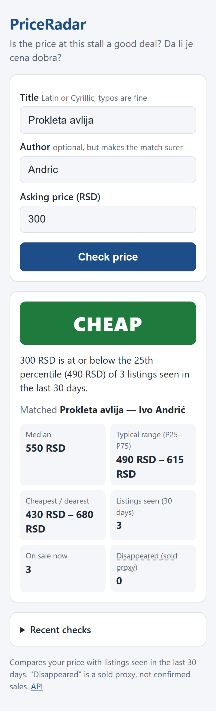
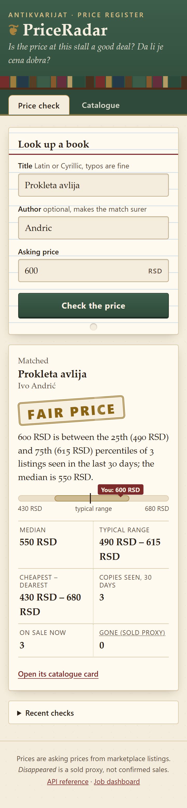
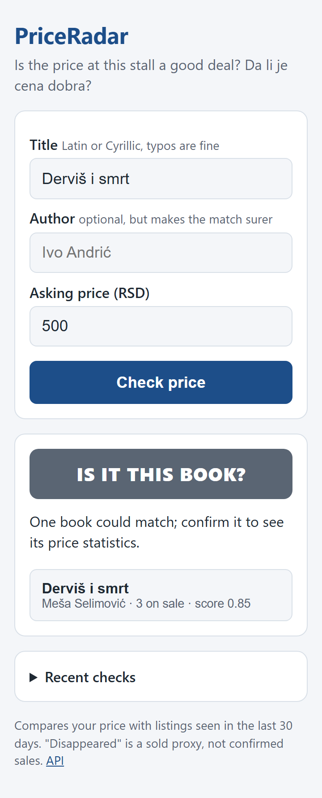
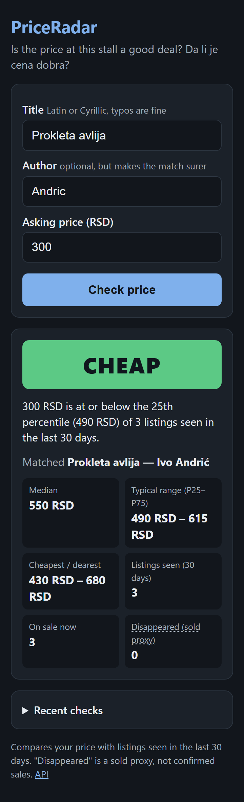

# PriceRadar — project summary

*What it is, what was built in the 10 days, how to test it yourself, and what is left. 4 November 2026.*

## 1. The idea

You are at a flea market and a seller wants 600 dinars for *Prokleta avlija*. Is that cheap, fair or expensive?
The answer exists, but it is scattered across hundreds of marketplace listings written in a dozen ways
("PROKLETA AVLIJA - Ivo Andric, kao nova", "Проклета авлија"), with no ISBN, and the sites never say what sold.

PriceRadar collects those listings into a small **data warehouse**, works out which listings are the **same book**,
keeps the **price history**, and answers the question from your phone in about 20 ms. It is a portfolio project, so
the real goal is to show professional backend work with evidence: a written spec, a clean architecture, measured SQL
optimisation, honest matching quality numbers, tests against a real database, CI and documented debugging.

## 2. What it does

| Part | What happens |
|---|---|
| **Ingestion pipeline** (Hangfire) | `POST /api/ingestion/runs` queues a run. Four jobs follow: **Scrape** (read listings into a staging table with `SqlBulkCopy`), **Match** (attach each listing to a book), **Resolve** (ask Claude about the unclear ones), **Load** (MERGE into the warehouse, one price snapshot per listing per run). Every step can be retried or repeated without creating duplicates. |
| **Matching** | Normalises text (Cyrillic → Latin, diacritics, noise words like "kao nova", years, roman volume numbers), finds candidate books, scores `0.7·title + 0.3·author`. ≥ 0.90 → automatic match; < 0.65 → new book; in between → Claude API, cached so each distinct string is asked at most once, with a budget cap. |
| **Sold proxy** | A listing missing from two runs in a row is marked *Disappeared*. Probably sold, but not certain, and the app says so. |
| **Verdict** | `GET /api/lookup` compares your price with the 25th–75th percentile of the last 30 days: **cheap / fair / expensive**, or *not enough data* below 3 listings. |
| **Phone page** | `http://localhost:5080/`: three fields, a big coloured verdict, the stats behind it, a "which book?" step when the match is unclear. |
| **REST API** | Books, stats, price history, ingestion runs; RFC 9457 error responses, API key for writes, rate limits, health checks, OpenAPI/Scalar. |

<div class="shots">
  
  
  
  
</div>

## 3. What was done, day by day

| Day | Delivered | Key evidence |
|---|---|---|
| 1 | Solution skeleton (Core / Infrastructure / Api / Worker), EF Core schema with 4 schemas, SQL Server in Docker | Migrations apply; health check |
| 2 | Fixture sources (incl. KP-style fixtures), bulk staging writer, synthetic seeder | 500k snapshots in ~15 s, reproducible with `--seed 42` |
| 3 | Hangfire pipeline, normaliser, warehouse load, sold heuristic | Re-running a run inserts nothing |
| 4 | Stats stored procedures, Dapper queries, Testcontainers tests, baseline benchmark | Integration tests on real SQL Server 2022 |
| 5 | REST API: books, stats, lookup verdict, API key, rate limits, ProblemDetails | `.http` file, OpenAPI document |
| 6 | SQL optimisation with measured before/after | Stats 6,809 → 49 reads; lookup p95 145.9 → 18.5 ms |
| 7 | Fuzzy matching, 169-row golden set, Claude resolver with cache and budget | 100 % precision, 88.7 % recall |
| 8 | Architecture tests, full CI (gitleaks, format, tests + coverage, Docker), correlation ids, debugging log | 221 tests, 94.7 % line coverage |
| 9 | Phone lookup page, full README, AI-usage log, MIT licence | Lighthouse accessibility 100 |
| 10 | Clean-clone rehearsal, CV bullets with real numbers, final polish | Fresh clone running in ~2.5 min |

**Final numbers:** 186 unit + 35 integration tests, all green · line coverage 94.7 % (Core 87.3 %) · hot-book stats
5 ms / 49 reads on 500k rows · lookup p95 18.5 ms at 838 req/s · matching precision 100 %, recall 88.7 % · 0 build
warnings, `dotnet format` clean.

## 4. How to test it yourself

You need **Docker Desktop** (running) and the **.NET 9 SDK**. Open PowerShell in the repository folder.

**Step 1: start the stack** (first time ~2 minutes):

```powershell
Copy-Item .env.example .env          # only the first time; your existing .env is fine too
docker compose up -d --build
curl.exe -s http://localhost:5080/health/ready      # "Healthy" once the Worker is up
```

**Step 2: run the pipeline on fixture data**, then watch it at <http://localhost:5080/hangfire>:

```powershell
curl.exe -s -X POST http://localhost:5080/api/ingestion/runs -H "X-Api-Key: dev-key" -H "Content-Type: application/json" -d '{\"source\":\"fixture\",\"fixtureSet\":\"run-001\"}'
curl.exe -s http://localhost:5080/api/ingestion/runs      # wait for "succeeded", then repeat with run-002 and run-003
```

(Your existing database already contains these runs and the 500k-row synthetic data, so you can skip this step.
A new run with the same fixture set is refused while another run of that source is active.)

**Step 3: use the phone page.** Open <http://localhost:5080/> and try:

| Title | Author | Price | Expected |
|---|---|---|---|
| Prokleta avlija | Andric | 300 | **Cheap** |
| Prokleta avlija | Andric | 600 | **Fair price** |
| Prokleta avlija | Andric | 1500 | **Expensive** |
| Проклета авлија | Андрић | 450 | Cheap (Cyrillic works) |
| Derviš i smrt | *(empty)* | 500 | "Is it this book?" → tap the candidate → Fair price |

From your phone on the same Wi-Fi: `ipconfig` shows your PC's IPv4 address; open `http://<that-ip>:5080/` (Windows
may ask to allow port 5080 through the firewall).

**Step 4: run the tests** (Docker must be running for the integration tests):

```powershell
dotnet test -c Release           # expect 186 + 35 passed
```

**Step 5: look at the evidence.** `README.md` (overview and numbers), `docs/benchmarks/BENCHMARKS.md` (SQL
before/after with plans), `docs/debugging.md` (six real incidents), `docs/ai-usage.md` (nine AI mistakes and how they
were caught), `docs/spec/PriceRadar-Spec.pdf` (the full specification).

**Step 6: stop it.** `docker compose stop` (keeps the data) or `docker compose down -v` (deletes the database).

## 5. What is left

These need you, because they publish things or depend on your accounts:

1. **Push to GitHub.** Days 8–10 are committed locally only (`main` is 3 commits ahead of `origin/main`). Pushing runs
   the new three-job CI for the first time: check that the `lint`, `build-test` and `docker` jobs go green, and that
   the README's CI badge shows *passing*. CI on GitHub has not been verified yet.
2. **Tag `v1.0.0` and publish a release** after CI is green; pin the repository and add topics.
3. **Try it on a real phone** over Wi-Fi (only tested at 360 px in a phone-sized browser so far).
4. **Enable Claude resolution** if you want it: put an Anthropic API key in `.env` as `ANTHROPIC_API_KEY` (never
   commit it). No real Claude call has been made yet; the resolver is covered by tests with a stub, so the live cost
   per run is still unmeasured.
5. **The CV entry and application**: the bullets with real numbers are in spec Appendix B.

Not built, by choice or cut for time:

- **Live Kupindo scraping.** The source is registered but disabled and not implemented (it was the first cut item).
  All data comes from fixtures and the synthetic generator. KupujemProdajem stays a fixture because its terms forbid
  copying.
- **Stretch list** (spec §2.4): Azure hosting, a manual match-review endpoint, outlier exclusion, PWA shell, images
  on GHCR, OpenTelemetry. A demo GIF and a Seq log profile were also left out.

**Known quirk:** `docker compose stop` ends SQL Server with exit code 137 (it ignores SIGTERM). This is harmless, but
identity values may jump by 10,000 after it (see `docs/debugging.md`).
